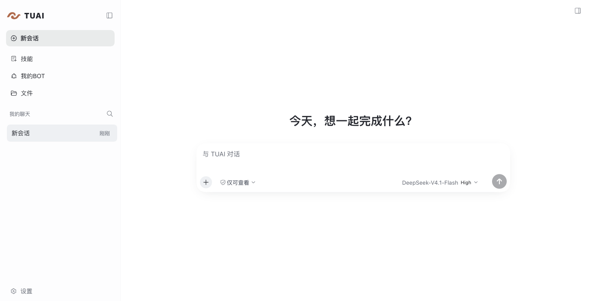
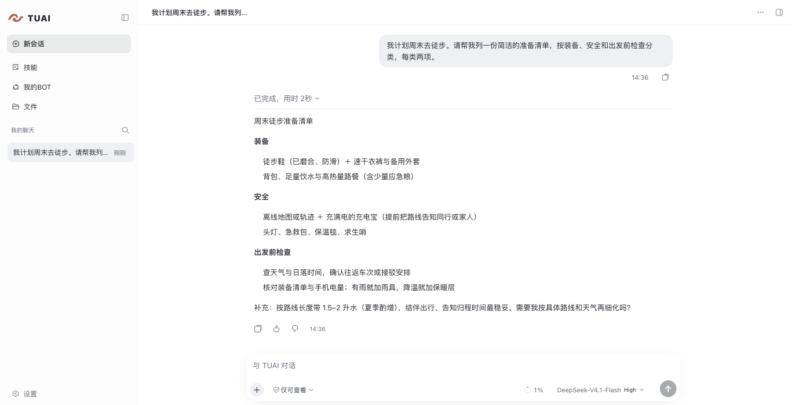
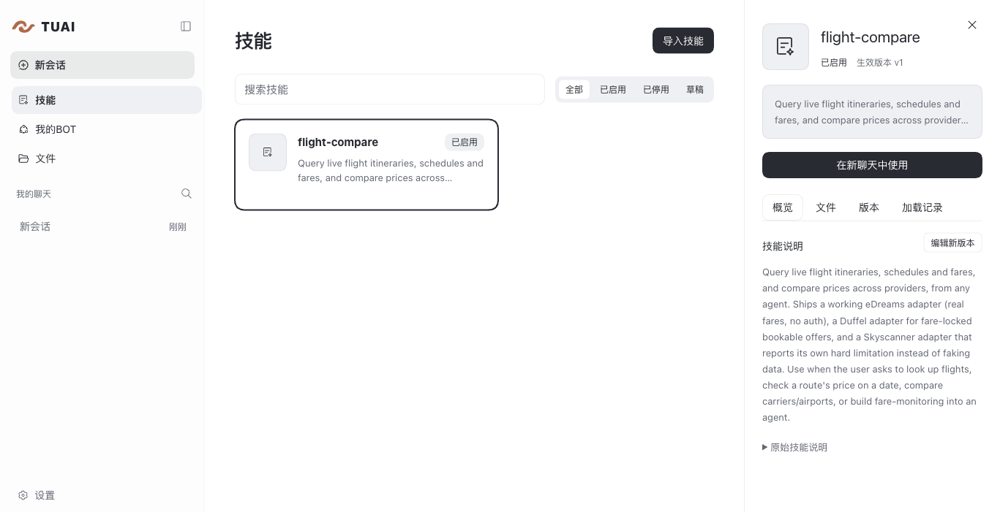
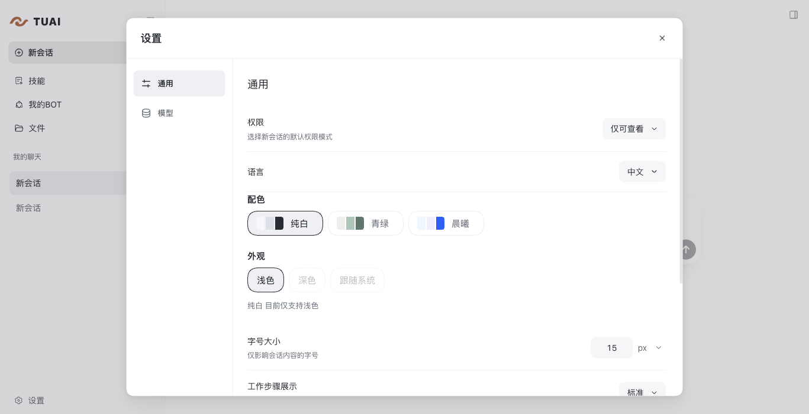

# TUAI · 同途


TUAI 是一款运行在本机的 AI 助理应用。你可以通过对话处理文件、调用工具、
使用技能，并在需要时接管浏览器操作。

目前，TUAI 已提供可运行的 Web 工作区，支持模型对话、文件管理、工具调用和
技能管理。本机浏览器接入仍在完善；长期任务、多 Agent 和桌面安装包尚未开放。

## 功能

- **对话工作区**：进行多轮对话，上传附件，搜索、置顶和归档会话，恢复已有记录。
- **工具与权限**：在授权范围内读取、编辑和搜索文件，运行 Shell、访问网页，并在需要时请求确认。
- **文件管理**：集中查看会话中的文档和图片，支持预览、下载和管理。
- **技能**：导入 Skill，检查和管理版本，在对话中调用已启用的技能。
- **浏览器**：连接本机安装的 Ego Browser，在工作区查看页面并进行人工接管。
- **个性化**：切换界面配色、外观、字号和语言，调整新会话的默认权限。

## 界面预览

以下截图来自本机正式运行的 TUAI，对话由实际模型生成，技能页面展示了已安装的实际技能。

**对话工作区**



**模型对话**



**Ego 浏览器接管**


**技能管理**



**个性化设置**



## 技术栈

| 层次       | 技术                                             |
| ---------- | ------------------------------------------------ |
| 前端       | React 19、TypeScript、Vite、HeroUI、Tailwind CSS |
| 应用运行时 | Node.js、Cordis、DeepSeek Harness Agent Loop     |
| 数据存储   | SQLite、JSONL 会话记录、本地文件存储             |
| 浏览器     | Ego Browser、WebSocket                           |
| 测试       | Vitest、Playwright                               |

## 快速开始

目前已在 macOS arm64 上验证。运行需要 Node.js **26.8.1**，以及用于构建原生模块的
C 编译器和 Node 头文件；macOS 可安装 Command Line Tools。Linux 和 Windows 尚未完成实机验收。

克隆项目并安装依赖：

```sh
git clone https://github.com/zneghao777/TUAI.git
cd TUAI
npx --yes pnpm@11.28.5 install --frozen-lockfile
npx --yes pnpm@11.28.5 run build
npx --yes pnpm@11.28.5 run build:web
```

### Web 工作区

启动本机 Host：

```sh
npx --yes pnpm@11.28.5 run start:web
```

在浏览器中打开终端输出的登录链接，默认地址为 `http://127.0.0.1:3100/`。
登录链接包含凭证，请勿分享。

进入 **设置 → 模型**，配置 DeepSeek API Key，或添加兼容 DeepSeek Messages 接口的
模型提供商。完成配置后即可开始对话。使用浏览器功能时，还需要在本机单独安装 Ego Browser。

### 命令行

配置模型后，也可以从终端发起对话：

```sh
node --expose-internals apps/cli/lib/index.js --prompt '你好' --session chat-001
```

配置与会话数据保存在本机的独立目录中。可以通过 `TUAI_HOME` 指定其他数据目录；
模型请求会发送至你所选择的服务商。环境变量凭据的配置方式见
[Host 配置示例](config/host.example.json)。

## 开发与测试

以下命令覆盖项目检查、技能和浏览器相关测试：

```sh
npx --yes pnpm@11.28.5 run check
npx --yes pnpm@11.28.5 run test:skills
npx --yes pnpm@11.28.5 run test:browser
```

## 许可证

TUAI 原创部分采用 [MIT License](LICENSE)。项目所包含的上游及第三方组件遵循各自的
许可证，相关版权和许可文件保留在对应目录中。
