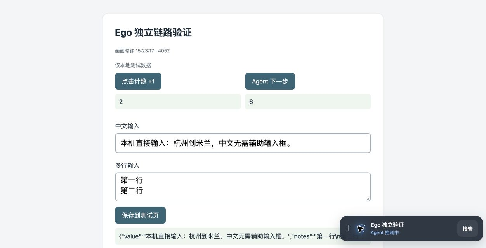
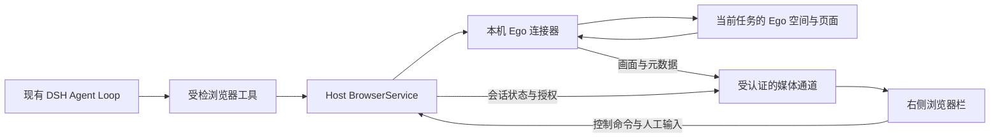

# P4：Ego 浏览器接入与右侧栏需求

本附录记录 2026-11-03 用户确认的浏览器接入方案：使用本机 Ego 执行任务，
在项目现有右侧栏按需显示同一任务的真实页面，沿用已验收原型的可拖动控制栏。
用户在面板中接管后直接使用鼠标和键盘，明确交还后 Agent 从当前页面继续。

2026-11-03 后续用户指令已授权正式实现 TZ-033～041；本轮不实施 P7 安装发布，
TZ-059 手机远程、外网、穿透和中继暂缓。独立原型不计为正式应用验收。
前置缺口和实际验证见[P4 接入验收](../../verification/P4-本机Ego接入验收.md)。
主约束见[项目开发规范 §9](../项目开发规范.md#9-浏览器能力迁移与接管)，
实施状态见[总开发计划](../../../总开发计划与进度记录.md)。

## 1. 已确认范围

下表区分当前选定的产品行为和后续扩展，避免把原型或远程设想当作已交付功能。

| 范围 | 要求与状态 |
| --- | --- |
| 浏览器执行端 | 首版优先连接本机已安装、已运行的 Ego；复用其受支持的任务空间和页面接口 |
| 页面范围 | 仅映射当前任务的页面和标签页；不能默认枚举或接管全部个人标签页、Profile |
| 展示入口 | 在现有右侧栏目中增加浏览器栏，需要时出现；与文件、产物等栏目共存 |
| 已确认交互 | 清晰画面、可拖动浮动控制栏、接管／交还 Agent、直接鼠标键盘输入 |
| 原型保留 | 原临时目录继续保留，作为正式开发的重要参考；验收通过不再触发删除 |
| 本轮实施范围 | 实施 TZ-033～041；只补浏览器必需的任务、租约与恢复前置，不扩展整个 P3 |
| 手机远程 | 保留扩展方向：手机连接在线电脑上的 Ego；尚未实现或实机验收 |

### 1.1 交互参考

已确认的是下图的简洁控制方式。正式界面沿用项目主题、按钮、焦点和布局规则，
不把测试页内容、示例任务名称或调试信息做成产品功能。

画面主体映射同一个 Ego 页面及其登录状态。不得通过 iframe 再次打开网站 URL、
复制 Cookie／Profile 或新建另一个内置浏览器，来代替对原页面的接入。

### 1.2 三类使用体验

正式实现必须同时覆盖以下三个角度，不因简化界面丢失已有能力。

- 用户：需要时在当前聊天旁看见页面，一键接管，直接输入，明确交还。
- 开发者：控制权、输入、图像和页面生命周期分层；类型、错误和诊断可以单独验证。
- Agent：继续使用 DSH Loop 和结构化观察／受检动作；人控时停止动作，归还后重新观察。

## 2. 右侧栏与控制栏

浏览器栏复用现有右侧栏注册、尺寸调整、标签和会话归属机制。
每个 BrowserSession 对应一个面板实例，面板内仅列出该任务的 Ego 页面标签。
不同任务、Execution 和浏览器资源必须按身份区分，不能按 URL 或标题合并。

### 2.1 按需出现与收起

出现规则根据任务事件触发，不根据画面帧触发。

| 事件 | 界面行为 |
| --- | --- |
| 当前聊天首次取得可用浏览器资源 | 创建或复用浏览器栏并展开；已有其他栏目和文件状态保留 |
| 当前任务需要登录、验证码或其他人工处理 | 展开对应浏览器栏，显示真实等待状态和接管入口；同一等待事件只提示一次 |
| 其他聊天的后台任务更新 | 更新任务入口及等待状态，不强切当前聊天或抢键盘焦点 |
| 用户主动收起或关闭浏览器标签 | 释放该视图的流和解码资源；保留任务、页面、控制权与重新打开入口 |
| 用户收起后仍有普通帧或工具进度 | 不反复自动展开；新的独立人工处理事件可以再次提示 |
| 用户重新打开 | 根据 Host 权威快照恢复当前页面、控制者和连接状态，不重建网站会话 |
| 切换聊天或任务 | 显示对应资源，旧订阅与输入焦点解除，不改变另一任务的控制权 |
| 任务结束 | 停止自动展开，保留按策略查看或重新打开的入口；释放策略与关闭网站区分 |
| Ego／连接器不可用 | 在栏目内给出简短失败状态和重连操作，不显示假画面或虚假“已接管” |

收起面板、关闭栏目、结束任务、关闭 Ego 页面是不同操作。
结束任务沿用项目已有入口；浮动控制栏不新增一排辅助操作。
面板可调整宽度并放大查看，窄屏使用单独的满屏视图，避免把整页压成不可读缩略图。

### 2.2 浮动控制栏

控制栏位于画面内，默认靠近右下角，可以拖动到不遮挡操作的位置。
位置按设备保存，尺寸变化后限制在可见范围；拖动控制栏不能穿透到目标网页。

| 状态 | 主操作 | 行为 |
| --- | --- | --- |
| Agent 控制中 | **接管** | 向 Host 请求控制权，收到确认后才启用人工输入 |
| 用户在面板控制中 | **交还 Agent** | 提交归还，确认新代次和当前观察后恢复原任务 |
| 控制权切换中 | 当前按钮忙碌 | 禁止重复请求，保留准确状态；失败时重新读取权威状态 |
| Ego 原生人控或连接中断 | 按真实能力显示归还／重连 | 不自动夺回 Ego 原生控制权，不把失联解释为归还 |

常驻内容只包含拖动手柄、必要任务名称、简短控制状态和当前主操作。
不保留辅助中文输入框、发送按键区、坐标填写、计数器、性能面板和原始日志。
诊断放入项目已有执行记录或诊断入口，错误与等待原因仍须可查看。
控件复用 DSH 已迁入组件和语义主题，覆盖深浅色、现有配色与中英意语言。
按钮具有可访问名称、键盘焦点及忙碌反馈；拖动另有键盘可达的复位方式。

### 2.3 直接输入与焦点

接管确认后，点击画面中的输入框即可打字，不要求用户移到独立辅助输入区。
输入焦点归属于浏览器画面时，聊天 Composer 和应用快捷键不能抢走网页操作。

- 支持鼠标按下／抬起／移动、单击／双击、拖选、滚动和常用修饰键。
- 支持中文 IME、候选选择、组合中编辑、确认／取消、多行、Tab、退格、方向键。
- 支持在用户操作和平台授权范围内复制、剪切、粘贴，保留选择区及换行。
- 输入法代理可以是隐藏的实现细节；不得把组合过程和最终文本重复提交。
- 失焦、归还、断线、切页时释放本通道持有的按键和指针状态；过期输入不重放。
- 系统保留快捷键如无法转发，必须提供明确边界；输入法候选窗位置需人工实机验收。

## 3. 接入架构与职责

Host 管理业务状态，Ego 连接器提供浏览器能力，右侧栏只呈现和提交已授权输入。
本轮已按下图接入分层；已验与未验边界以正式验收记录为准，不能仅凭架构图标记任务完成。

| 层次 | 负责 | 不承担 |
| --- | --- | --- |
| 现有 DSH Loop／TaskRuntime | 模型决策、执行与等待、恢复原目标 | 不另启浏览器专用 Agent Loop |
| BrowserService | owner、Task／Execution、租约、控制代次、动作授权、审计和事务 | 不把画面帧或模型自述当任务完成事实 |
| Ego 连接器 | SDK 能力探测、任务空间／页面映射、结构化观察、受检执行、画面、输入、生命周期 | 不自行批准、跳过人控或管理第二份任务状态 |
| 媒体与输入适配 | 二进制画面、背压、尺寸元数据、低延迟输入与回执 | 不向 Renderer 暴露任意 CDP、Node、Shell 或 Profile |
| 右侧栏 | 按需打开、页面标签、清晰画面、控制栏、焦点、坐标转换 | 不成为控制权或网站状态的权威来源 |

Agent 默认使用 Ego 的结构化快照、当前 Ref、语义控件和可检查批量动作。
人控视频流不能取代 Agent 的结构化观察；批处理仍逐步检查控制代次与取消。
截图／坐标仅作为有当前页面证据的补充，不能把历史坐标固化为网站脚本。

### 3.1 现有代码入口与拟新增模块

以下入口已核对源码。表中“拟新增”必须在实施时完成类型、注册、构建和验收，
不直接把临时脚本复制进应用。

| 入口 | 接入方式 |
| --- | --- |
| `apps/web/src/model/client.ts`、`chat-runtime.ts` | 在既有 Connection／Remote／聊天组装中挂载浏览器对象层和栏目插件 |
| `apps/web/src/components/ArtifactPane.tsx` | 参考当前产物栏的注册与清理方式，保留其现有行为 |
| `packages/client/ui-sidebar-right/src/client/service.ts` | 复用 `sidebarRightTabs`、`sidebar.right.pane.tab` 和 `sidebarRight.openTab` 等公开契约 |
| `packages/client/ui-sidebar-browser/src/client/definition.tsx`、`view/BrowserPresentation.ts` | 参考浏览器标签和呈现分层；新增 Ego 适配，不启用原 iframe／Electron 新开网站实现来冒充 Ego |
| `packages/product/agent-runtime/src/core.ts` | 在现有 DSH 工具注册与权限链中挂载浏览器工具和 Reviewer |
| `packages/product/web-host/src/index.ts` | 沿用认证和 Remote 挂载方式，接入浏览器控制 API；图像端点使用相同资源授权 |
| `packages/product/platform/src/index.ts` | 扩展真实能力协商；现有 `embeddedBrowser`／`managedBrowserWorker` 布尔值不代表 Ego 可用 |
| 拟新增 `packages/product/browser-service/`、`ego-connector/` 与浏览器客户端适配 | 分别保存领域服务、SDK 边界和呈现／输入；包名与进程入口在 TZ-033/035 冻结 |

迁入的 `ui-sidebar-browser` 当前包含创建 iframe／Electron 页面的实现，
不是已完成的 Ego 桥接。优先复用侧栏、通用控件和呈现契约，媒体解码、IME 和
Ego SDK 适配独立实现；不存在对应通用控件时，不强行套用原地址栏和导航流程。
涉及迁入文件修改时补充来源、许可与补丁登记。

### 3.2 Ego 连接器边界

连接器只使用当前安装版本支持的接口，启动时探测并报告实际能力。
原型查阅的是 Ego 本地 API 指南 v2.2.0，不代表浏览器应用版本已核验。

- 以 Task／Execution 映射 Ego TaskSpace，并管理该任务的页面标签；不能硬编码原型空间 ID。
- 使用当前页面句柄、快照与引用；页面切换、原始 CDP、重连后使旧引用失效。
- `page.events()` 是缓冲事件读取接口；不能当作原生 EventEmitter 使用。
- 只在连接器内部封装所需 CDP 能力并校验参数；不假定所有 CDP 命令都支持。
- 按 SDK 取消、用户控制和任务空间生命周期处理失败；句柄上的 ownership 快照不能代替持续核验。
- Profile、登录数据和个人页面留在 Ego；产品保存授权映射，不复制到 Skill 或普通日志。
- 连接器进程可以重启，重启后先核对租约、原空间和控制状态，不盲目创建新任务或重放动作。

### 3.3 从工具执行到打开栏目

前后端通过资源身份和状态事件联动，不通过解析模型回答、工具名称关键词或网站 URL 打开栏目。
下列事件名称是逻辑含义，精确类型在 TZ-035 的协议注册中冻结。

1. 浏览器工具先向 BrowserService 取得绑定当前 Task／Execution 的 BrowserSession，
   返回可授权解析的资源引用，并在真实工具记录中关联该引用。
2. 浏览器客户端对象层通过 `browsers.follow` 获取快照与资源可用、页面变化、
   需要人工、控制变化和结束事件；关联当前聊天使用 SessionBinding，不用标题猜测。
3. 当前聊天首次资源可用或出现新人工等待时，按 §2.1 调用右侧栏公开入口。
   栏目参数保存 BrowserSession 身份，Ego 空间、页面目标和授权由 Host 解析。
4. 栏目可见时才申请媒体订阅，收到带 viewport 的当前帧后启用准确映射；
   人工输入还需接管成功的控制代次，不能仅因画面可见就开放。
5. 切换聊天、隐藏栏目或连接代次变化时，取消旧订阅、解码和输入监听；
   重新显示先取快照，再连当前流，不重发上一个视图遗留的动作。

## 4. 控制权、输入与归还

控制权必须同时反映产品的控制者与 Ego 原生状态。
原型已验证“连接层人控”，尚未证明 Ego 原生 handOff 后仍可持续代理画面和人工输入。
两条路径必须分别记录、分别验收。

### 4.1 面板接管

面板接管由产品停下 Agent，连接器作为人工输入的执行代理。
即使 SDK 仍持有 Ego 执行句柄，也不能把它解释为模型仍可操作。

1. 校验用户身份、BrowserSession、资源版本和当前控制代次，以 CAS 申请人控。
2. 递增 `controlEpoch`，撤销旧 Agent 租约的动作资格，暂停待发动作与批处理。
3. 在每次真正派发前再次检查代次；已发送动作记录实际回执或未知状态，不能宣称撤销。
4. Host 确认人控后开放该控制连接的输入；其他设备和 Agent 的变更请求全部拒绝。
5. 人工输入携带 Browser／页面、代次、连接身份、单调序号及所依据的 viewport 版本。
6. 用户明确点击 **交还 Agent**；停止接受旧人工输入，递增代次，重新取得权威控制状态。
7. 重新观察当前页面，清除旧 Ref、Reviewer 与已失效批准，恢复原 Task／Execution 目标。

原型的“Agent 下一步”按钮只是受控测试计数，正式归还必须唤醒原执行流程，
不能硬编码一次示例点击或创建新聊天来冒充继续任务。

### 4.2 Ego 原生接管与冲突

用户也可能在 Ego 窗口中使用其原生接管入口。产品必须遵守 Ego 的控制限制，
不能在该状态下通过另一条 CDP、CLI 或 SDK 通道绕过人控。

原生控制信号、授权拒绝或空间失效发生时，BrowserService 立即停止 Agent 派发，
提升产品控制代次并同步准确状态。不能只依赖错误字符串正则或旧 ownership 值。
若使用原生 `handOff()`，按 SDK 契约结束本次执行；只有明确的人类归还事件
才允许调用 `takeOverTaskSpace()` 重新取得同一空间。

SDK 原生交接若暂停画面或代理输入，面板必须如实呈现能力受限和可行入口；
正式双入口协同必须通过 EGO-08，不能用面板原型通过来替代。
归还、双设备冲突和断线都以 Host CAS 与实际 Ego 状态为准，超时不得自动抢回。

### 4.3 协议与认证

控制命令沿用 Typert／Remote；媒体使用专用二进制通道。
具体字段在实现时生成精确类型和 codec，以下是必须保留的逻辑合同。

| 合同 | 必须包含与校验 |
| --- | --- |
| 资源快照 | Host、BrowserSession、Task／Execution、页面列表、租约、revision、controlEpoch、产品控制者、Ego 状态、可用能力 |
| 控制请求 | requestId、BrowserSession、expectedRevision、controlEpoch；owner 与调用方由认证上下文解析 |
| Agent 动作 | Execution／租约、代次、当前观察及页面引用、动作身份、授权与事务检查 |
| 人工输入 | 控制连接、代次、输入序号、页面、viewport 版本、类型与受限参数；旧输入和不确定送达输入不重放 |
| 画面帧 | BrowserSession／页面、流代次、frameId、采集时间、CSS 尺寸、像素尺寸、DPR、格式与 viewport 版本 |
| 回执与失败 | accepted／executed／rejected／unknown 的实际含义、关联请求和错误；“已发送”不等于页面生效 |

帧号、流代次、产品资源 revision 和 `controlEpoch` 分别管理。
画面和输入端点校验同一产品身份及任务资源，重连必须重新认证和取得快照。
不得在查询参数、诊断或源码中泄露长期 Token、Cookie 或个人 Profile 路径。
Renderer 不直接访问 Ego 本地端口；本机连接也必须校验来源与控制会话。
Skill、MCP、Shell 和批处理调用 Ego 时同样经过网关和最终工具权限，
不能只靠提示词约定来阻止原始 CLI／CDP 绕过控制检查。

## 5. 本机画质与延迟

当前选用原型已跑通的原生尺寸 PNG 和本机二进制 WebSocket 作为接入基线。
先保证文字清晰、输入直接和队列不积压，再按实际测量决定是否更换编码或传输。

### 5.1 渲染与传输要求

画面尺寸与输入坐标必须来自同一版 viewport，不能通过提高 CSS 宽度放大低清截图。

- 保留源画面实际像素和 DPR；Canvas backing store 与 CSS 显示尺寸分离。
- 去除旧原型的 1200 像素上限、JPEG 72 压缩和固定 65ms 轮询等待。
- 连接器把收到的帧转换为二进制后传输，避免逐帧 HTTP 上传和 Base64 SSE 再封装。
- 输入和画面读取分开调度；每客户端只保留有界的最新待绘制帧，及时确认源帧，慢客户端不拖住 Agent 或其他视图。
- 按源 CSS 尺寸、显示区域、留白和缩放反向转换鼠标坐标；viewport 改变时拒绝旧版本输入并刷新映射。
- 侧栏变窄时等比例显示并支持放大，不默认改变真实网页 viewport、重载页面或重建 Profile。
- 隐藏面板释放解码与显示订阅；任务继续时保留 Ego 页面。未聚焦、最小化和休眠分别测量，不混为后台能力。

WebRTC、视频硬编码、系统共享纹理可在后续有测量依据和 Ego 支持时评估。
目前没有原生零拷贝嵌入已验证的证据，不把选项写成现成接口或低延迟保证。

### 5.2 原型实测与正式验收预算

2026-11-03 的数据来自本机回环、受控测试页，记录于原型 `PERFORMANCE-v2.json`。
源 CSS 为 1355×723，DPR 为 2，PNG 为 2710×1446。

| 指标 | 样本 | 中位数 | P95 | 指标边界 |
| --- | --- | --- | --- | --- |
| 输入请求到回执 | 79 | 16.1ms | 19.2ms | 不包含输入后画面变化和物理屏幕显示 |
| 键盘请求到回执 | 12 | 8.4ms | 16.1ms | 小样本，不作为所有输入法的性能保证 |
| 采集到 Canvas 绘制 | 179 | 32.2ms | 40.3ms | 热状态帧龄，未含物理显示扫描 |

正式本机初始验收预算为输入回执 P95 ≤50ms、采集到绘制 P95 ≤80ms。
实施时在目标机器冻结环境、尺寸、负载及时间测量方式，至少连续运行 60 秒并采集
200 次输入，报告冷启动、热状态、帧率、队列和内存；不同进程时钟需校准。
同时记录输入到页面实际变化的端到端延迟，不把上述两项相加冒充完整体验指标。
原型小样本不是普遍帧率、互联网或所有机器上的承诺；偏离预算须定位并记录。

## 6. 手机远程扩展

手机访问的是电脑上的同一个 Ego 任务页面。成立条件是电脑在线且保持可执行状态，
Host／桌面桥、连接器和 Ego 正常运行，并存在经过认证的可达通道。

本机首版保留 Host 身份、能力协商、远程媒体／输入与控制代次合同。
远程 Host 控制本机 Ego 时，需增加电脑端连接器桥；手机上的 `127.0.0.1`
不能当作电脑地址。后续再实现配对、加密连接、穿透或中继、触控与软键盘输入。
连接断开保持暂停／人控，不因手机离线自动交还。
本轮不宣称手机、外网、最小化、锁屏或休眠可用；手机实机验收属于后续多端范围。

## 7. 原型参考与保留规则

用户已撤销“验收后删除”的原要求。保留目录为：
`/private/tmp/tianzhiai-ego-poc-20261103-D1K6aD`。
后续只有新的明确清理指令才执行删除，不以本次认可或任务结束触发清理。

| 原型文件 | 参考用途 |
| --- | --- |
| `bridge-server.mjs`、`bridge-worker.mjs` | v2 二进制画面桥、输入队列与 Ego SDK 调用边界 |
| `viewer.html`、`viewer.js` | 已确认的高清画面、浮动控制栏、直接输入及坐标映射 |
| `target.html` | 受控本地测试页，只包含合成数据 |
| `floating-toolbar-proof.png` | 已确认界面；文档已保存独立副本 |
| `PERFORMANCE-v2.json`、`quality-probe.json` | 性能分段数据和画质对比 |
| `RESULTS.json`、`v2-events.jsonl`、`final-viewer-state.json` | 验证回执；v2 状态看 `latestState`，旧字段不作为当前控制权 |
| `server.mjs`、`worker.mjs`、`panel.*`、`v1/` | 早期辅助输入面板，仅留历史，不作为正式 UI 基线 |

启动入口为目录内 `bridge-server.mjs`；当次回环预览地址为
`http://127.0.0.1:57435/`，是否可用以实际进程为准。
复验前读取目录内说明，核对 Ego 空间与端口，不能把固定空间 ID、页面标签、
端口、绝对路径、未认证回环服务、内存状态和示例恢复动作带入正式产品。
正式产物不得依赖临时目录、个人 Skill 安装路径或同级参考仓库。

原型验证过未聚焦取帧、面板点击、中文提交、多行、常用编辑及剪贴板操作、
拖动控制栏和连接层归还后示例继续。未完成物理拼音候选窗、Ego 原生交接同步、
正式 Agent 任务恢复、手机／外网、最小化／锁屏和完整交易验收。

## 8. 开发顺序与验收

沿用现有 P4 的九个任务，不新建第二套任务或把原型验收计入应用进度。
依赖与状态以总计划为准；在正式任务依赖尚未齐备时，可以继续独立验证适配能力。

| 顺序／任务 | 本轮明确的接入交付 |
| --- | --- |
| TZ-033 | Ego 能力探测、连接器生命周期、任务空间映射、来源与许可边界、受控网站 |
| TZ-034 | 结构化观察、当前 Ref／Frame 与受检动作；验证页面变化及不支持场景 |
| TZ-035 | BrowserService、领域类型／codec、持久状态、租约、DSH 工具、Reviewer 与权限网关 |
| TZ-036 | 右侧按需浏览器栏、任务页面标签、PNG／二进制流、浮动栏、直接输入、焦点与性能 |
| TZ-037 | 面板和 Ego 原生控制同步、代次失效、暂停与明确归还、原任务重新观察继续 |
| TZ-038／039 | 原有具体批准、事务意图、回执、未知结果核验；不得因更换 provider 丢失 |
| TZ-040 | Profile／用户页面隔离、下载产物、资源释放、断线恢复、日志脱敏和诊断 |
| TZ-041 | 在正式聊天内完成出行及真实接管，收集 EGO、BROWSER、HANDOFF、TX 证据 |

专项案例使用 EGO-01～12，定义在[验收场景 §6.2](验收场景与需求追踪.md#62-ego-接入与按需侧栏)。
每项记录实际环境、版本、输入方式、页面收件证据和未验证范围，
不能用 SDK 回执、截图、mock 或原型测试替代正式产品的真实接管验收。

## 8. 本轮正式实现状态

TZ-033～035 的连接器、结构化观察、BrowserService 和 DSH 工具已接入正式 Host。
TZ-036～041 的侧栏、直接输入、控制权、具体批准、未知结果和资源限额已实现，
自动化与实际人工验收分别记录。用户已反馈实体输入与接管没有问题，并要求简化
顶部网址／页面标题及缩放控件；重复标题移入页面菜单，缩放改用有可访问名称的图标。

原生 Ego 人控期间 SDK 画面暂停，正式侧栏显示真实状态，保留明确归还入口；
不以断线或超时自动接回。恢复时以实际用户页面重新观察，不固定选择任务的第一个标签。
浏览器任务保留到用户停止；DSH 输出一段查询结果本身不结算业务任务。

[P4 验收记录](../../verification/P4-本机Ego接入验收.md)列出命令、输入方式、
页面证据、实测和剩余缺口。[总计划](../../../总开发计划与进度记录.md)按完成标准
维护勾选，P4 出口仍取决于真实归还、Chief/长期出行助手和完整范围验收。
