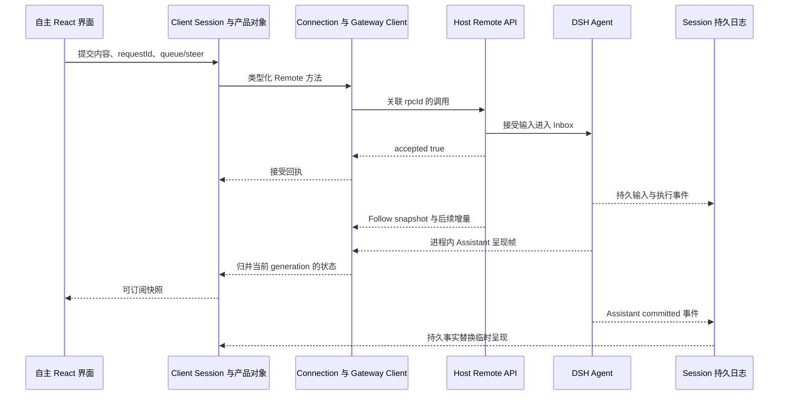

# 前端、Agent 协议与多端源码参考

本附录供 TUAI 迁移前端时使用，说明 DSH 中哪些实现需要保留，
哪些可以参考行为后重新实现，以及 Web／Desktop 如何共用同一套产品能力。
所有“上游”说明均对应主规范锁定的提交，路径以 DSH 仓库根目录为起点。
2026-10-27 起，P2 对话范围按[P2 换壳对齐需求](P2-DSH换壳对齐需求.md)实施：
默认迁入成熟交互与呈现模块再换主题。下文 §8 保留旧 P2 的实际处理记录，
不作为允许继续简化交互的依据。

## 1. 前端独立设计的边界

2026-10-29 起，P2 的页面结构和交互呈现按 [HeroUI 组件改造需求](P2-HeroUI组件改造需求.md)自主设计；DSH 功能、状态与协议语义继续保留。下表中以原结构为准的叙述属于此前迁移基线。
不要把“前端重做”理解为从 WebSocket 开始重写所有状态处理。

| 层次 | 优先处理方式 | 可以自主决定的部分 |
| --- | --- | --- |
| Wire contract、类型生成、RPC、流 | 迁入并验证兼容 | 产品新增 API 命名与独立版本策略 |
| Connection、Session、Assistant 流归并 | 优先迁入原对象层，外加产品适配 | 公开给页面的 ViewModel 与选择器 |
| Task、Agent、Browser、Plan 数据对象 | 产品自行实现，参考 DSH 分层 | 业务模型、页面投影和订阅方式 |
| React 绑定、Slot、注册与资源生命周期 | 迁入所需基础设施与公开契约，产品层薄适配 | 产品组合和视觉替换 |
| Composer、工具卡片、审批交互 | 迁入状态机、投影与交互组件；重写需等价证据 | 不改变行为的样式、材质、排版和动效 |
| 基础组件与主题 | 优先迁入原组件、键盘、焦点、无障碍行为 | 不改变结构与交互的视觉 Token 和品牌 |
| Desktop 主进程与平台桥 | 迁入并产品化 | 自有应用标识、安装流程、菜单和更新 |

不默认加载上游全部 UI 插件。采用原插件时必须满足它的服务、Slot 和样式依赖；
自主组件必须通过同一数据契约接入，不能直接修改 Session 的内部数组。

## 2. 必须理解的调用链

下图描述逻辑职责，不规定所有平台必须使用同一物理载体。
Desktop 可以通过受限 IPC 桥接相同语义，而 Web 使用 HTTP／WebSocket。



该图省略了生成 codec、服务端访问控制与流多路复用细节。
实际实现必须调用迁入库，不根据这张图重新手写整个 Wire 层。

### 2.1 连接与认证

DSH 的 `CONNECT_PATH` 是 `/connect`。Connection 管理 Host、连接代次、
重连和取消；认证、浏览器信任检查与 API Peer 入站检查不是同一件事。

实现必须做到：

- 未认证、禁止访问、Host 不在线分别呈现，不能统一写成“模型错误”。
- 连接重建时使旧代次的回调失效，包括仍在进行的 HTTP 结果。
- 在反向代理前缀下正确解析路径，不把所有地址硬编码为站点根目录。
- Web 的 Origin／Host／Token 检查、Desktop 的 IPC 调用方检查保持同等授权目标。
- 远程连接不能因地址是内网或 localhost 字符串就跳过认证。
- 前端不能持有模型服务端密钥或 Worker 管理 Token。

### 2.2 单次 RPC

锁定版本的载体无关信封如下。这里只展示信封；`payload` 的真实结构由 Typert
生成代码负责，不能直接把任意 JavaScript 参数 JSON 化当成正式协议。

```ts
interface ClientRequest {
  type: 'client-request';
  rpcId: RpcId;
  method: string;
  payload: unknown;
}

interface ServerResponse {
  type: 'server-response';
  rpcId: RpcId;
  result:
    | { ok: true; value: unknown }
    | { ok: false; error: { code: string; message: string; details: object } };
}
```

`rpcId` 标识一次传输调用；`SessionPromptRequest.requestId` 标识具体用户输入。
它们不能互相替代。重试传输必须保留同一业务输入身份，避免制造新的用户任务。

Web RPC 使用相对于文档的 `${channel}/${endpoint}` 路径。
二进制结果另有 attachment／multipart 处理；图片、文件和字节流不能都改成
没有大小限制的 JSON 字符串。传输错误与业务拒绝分别保留错误码和诊断。

### 2.3 Remote Stream 与事件交互

Web Remote Stream 的路由是 `/api/remote.mux`。多个逻辑流共享连接，
使用 `streamId` 区分；open、item、end、cancel 与 error 的含义以迁入类型为准。
某个流结束不能直接关闭其他任务正在使用的整个 socket。

Gateway 的内部事件端点为 `$events` 与 `$events/result`。
`ready` 为当前事件连接分配 `clientId`；需要客户端回答的 waterfall 带有
`eventId`、`agentId`、request 和取消生命周期。结果包含：

- `next`：此客户端处理器不作最终回答，继续事件链。
- `result`：返回已定义类型的结果。
- `rejected`：处理失败，返回结构化错误。

用户审批或问题卡片必须关联当前代次。另一窗口、已取消请求、旧连接的回答
不能随意完成当前等待。浏览器购买批准还必须增加持久事务绑定，不能仅凭
这个进程内 waterfall 充当跨重启批准凭证。

## 3. Session API 与聊天状态

Session Client 承担历史、实时执行和队列的组合。页面只订阅其对外契约。
产品 Task 的执行状态另由 Task Client 管理，不能从 `session.running` 猜出父子任务完成。

### 3.1 主要接口及界面含义

下表是上游方法语义摘要。参数与返回值最终以迁入类型生成结果为准。

| 接口 | 参数重点 | 自主界面需要处理 |
| --- | --- | --- |
| `session.list`、`search` | 范围、查询与分页 | 空结果、加载失败、分页、不在当前 Host 的历史 |
| `session.create` | `workspaceId` 与 `cwd` 互斥；可指定 `sessionId` 和 `agentPreset` | 返回的实际 Session ID 可能不同于请求值，不假定新建必是空白 |
| `session.modelCatalog`、`selectModel` | 模型目录与选择 | 模型实际可用性、权限、Host 配置与不可用原因 |
| `session.prompt` | `requestId`、`sessionId`、`mode`、`content`、`clientTimeZone` | 已接受与执行完成分开；错误后保留草稿 |
| `session.updateQueue` | 待处理项身份与变更 | 编辑和移除队列，避免改已消费输入 |
| `session.cancel` | 被取消运行的范围 | 展示停止中与停止完成；取消不能撤销已发生外部效果 |
| `session.page`、`follow` | Session address、窗口、游标与实时选项 | 分页缺口、首次 snapshot、重连和增量归并 |
| `session.attachment` | Session 与附件身份 | 下载和预览权限；不可从另一个 Session 猜 ID 读取 |
| `session.rename`、`fork` | 名称；fork 的 `atSeq` 与迁移选项 | 确认历史边界和新分支身份，不复制前端未提交内容 |

### 3.2 输入与附件

输入内容保留 text、image、file 的类型区别。锁定版本 image 可以包含编码内容与
媒体类型；file 引用上传后的 receipt。前端显示附件名称不代表 Host 已持久接收。

Composer 至少区分以下过程：

1. 编辑草稿和引用块。
2. 上传／验证附件，失败时允许重试或移除。
3. 准备本次不可变提交内容及业务 requestId。
4. 请求接受，失败时保留草稿与明确失败状态。
5. 等待持久输入确认，归并至聊天和队列。
6. 展示执行过程、问题、批准、结果或取消。

`queue` 和 `steer` 的区别必须在交互设计中可理解；不能把运行中的所有发送都强制
改成取消再新建。中文输入法合成阶段不能误触 Enter 提交，附件上传期间的状态
也不能被普通按钮禁用逻辑掩盖。

### 3.3 Follow、临时流和持久事件

Follow 先返回 snapshot，包括 `header`、`cursor`、`records`、`hasMore`、
`projections` 和可选 `assistantStream`。之后返回持久 SessionEventEntry，
或包含 start／chunk／end 的 assistant-stream 帧。

| 顺序标识 | 作用域 | 不能混用的原因 |
| --- | --- | --- |
| Connection generation | 一次有效连接生命周期 | 新连接必须拒收旧连接回调 |
| Session `seq/cursor` | 持久日志 | 适合恢复与去重，不等同于流 Token 索引 |
| Assistant `attemptId` | 一次模型尝试 | 重试的流不能接到上次回答末尾 |
| Assistant `revision` | 进程内呈现修订 | Host 重建与 Follow baseline 需要一致性 |
| Assistant chunk `index` | 单次流的密集位置 | 用来检测顺序和缺口，不能代替日志游标 |
| 产品 Task `version` | 任务状态并发控制 | 不由聊天历史条数决定 |
| Browser `controlEpoch` | 操作权代次 | 不由连接状态或 UI 上谁在看页面决定 |

`end.outcome` 为 committed 时关联 `assistant/message` 或 `assistant/attempt`
的持久 `seq`；为 abandoned 时不能继续冒充最终回答。
断线后的开场 baseline 可能包含已累积流及 `nextIndex`，不是让客户端重新逐字播放。
持久事件到达后，应归并替换临时视图，避免同一回答出现两遍。

产品新增 Task／Browser 流也采用“权威 baseline＋有序增量＋重连重取”的原则，
具体类型由产品定义，不把它们伪装成 DSH 原生 SessionEvent。

## 4. 前端分层与组件契约

DSH 当前客户端以 React 为呈现层，但连接、Session 等对象不依赖 React。
TUAI 延续这个分工，便于整体换视觉和支持多种客户端。

### 4.1 对象层、绑定层和视觉层

建议建立如下产品接口。以下为拟议形式，具体类型在实现时确定。

```ts
interface ReadableSource<T> {
  getSnapshot(): T;
  subscribe(listener: () => void): () => void;
}

interface TaskViewModel {
  id: string;
  status: string;
  children: readonly { id: string; status: string }[];
  pendingInteractions: readonly { id: string; kind: string }[];
}
```

视觉组件接收普通数据和回调；绑定层订阅 Source 并处理销毁；对象层调用 Remote。
框架 Hook 不进入领域包，React 组件不直接读取 Host 文件或执行 Cordis 服务。
单个业务事实不得在 Session、全局 Store 和组件 `useState` 中同时成为可写主状态。

### 4.2 Slot 与模块注册

采用 DSH Slot／注册机制时，注册记录必须由 Context 生命周期回收。
纯粹更换视觉组件可以保留 Slot contract，减少与工具、审批和子任务扩展的耦合。

- Composer、主内容、工具节点、问题面板和侧栏分别定义清晰扩展位。
- 工具插件注册呈现描述，不直接操作其他插件的 DOM。
- 未识别工具使用 Generic 卡片，保留名称、参数、结果和错误。
- 模块卸载时销毁订阅、热键、定时器与注册项。
- React、ReactDOM、Cordis、Typert 注册器保持共享实例。
- 不同时保留两套键盘管理和焦点系统处理相同快捷键。

### 4.3 组件逐项要求

自主 UI Kit 至少覆盖以下行为，而非只做同名样式组件。

| 组件范围 | 必须保留的行为 | 可以自主设计 |
| --- | --- | --- |
| Button／Input／Switch／Tabs | 禁用、忙碌、键盘、标签与焦点 | 尺寸、颜色、密度与过渡 |
| Modal／Menu／Popover | 焦点返回、Escape、层级、屏幕内定位 | 布局和视觉 |
| Markdown／Code／Diff | 安全链接、代码边界、长内容折叠、复制反馈 | 排版、字体与配色 |
| Composer | IME、引用、附件、草稿、排队、steer、取消 | 工具栏、布局和提示语 |
| Tool 卡片 | 原过程分组／折叠、专用参数和结果、错误、耗时、下载与嵌套调用 | 不丢内容的排版与配色 |
| Approval／Question | 准确资源、等待、取消、失效、选择和输入 | 卡片呈现，不能改变批准语义 |
| Browser 工作区 | 按需右侧栏、同一 Ego 任务页面／标签、高清画面、直接输入、控制权与归还 | 沿用已确认的可拖动控制栏，适配项目主题 |
| Agent／Task | 定义版本、执行者、父子关系、证据和等待原因 | 图、列表、分组与导航 |
| Skill／MCP | 来源、版本、权限、健康和验证状态 | 管理页面布局 |
| Plan／Notification | 时区、下次发生、暂停、渠道回执 | 日历、列表和提示方式 |

安全渲染要求沿用已审查实现：不直接执行工具返回的 HTML／JavaScript；
外链与下载显示来源；输出超长时截断呈现但保留原始可下载文件和权限检查。
不能为了界面简洁隐藏实际错误、批准拒绝或未完成状态。

2026-11-03 的浏览器范围以 [P4：Ego 接入与右侧栏需求](P4-Ego浏览器接入与右侧栏需求.md)
为准。复用 `sidebarRightTabs` 与 `sidebar.right.pane.tab` 注册栏目，
在产品 `apps/web/src/model/chat-runtime.ts` 的既有右侧栏组装中接入浏览器适配。
注册与资源清理参考 `apps/web/src/components/ArtifactPane.tsx`；
收起只结束视图订阅，不关闭 Ego 页面或归还控制权。
控制 API 走统一 Remote；二进制媒体和人工输入使用相同用户、资源和代次检查。

## 5. 多端的基础设计

同一前端应用通过 Platform 能力对象识别当前环境，避免在组件中分散判断
`process.platform`、Electron 是否存在或路径分隔符。

### 5.1 共享与平台专有范围

共享部分是领域类型、Connection／Session／Task Client、组件、工作流状态和业务 API。
平台专有部分包括窗口、菜单、文件选择、密钥存储、进程启动、系统通知与更新。

| 能力 | 浏览器 Web | 桌面应用 | 移动 Web |
| --- | --- | --- | --- |
| Agent 运行 | 连接 Host | 启动本地 Host 或连接远程 Host | 连接远程 Host |
| 本地路径 | 使用浏览器上传或 Host 文件浏览 | 通过受限原生文件选择 | 使用系统上传选择 |
| 浏览器 Agent 画面 | 访问 Worker 的受权控制流 | 同等控制协议，可有本机优化 | 自适应画面与触控映射 |
| 凭据 | Host 保存，客户端只持有会话凭证 | Host 保存＋平台 Keychain 能力 | Host 保存 |
| 主动通知 | 在线渠道／站内，浏览器权限另处理 | 系统通知＋在线渠道 | 依可用渠道和 Web 能力 |
| 安装更新 | Host 发布静态资源 | 签名安装与产品更新链 | Web 安装能力；原生另立项 |

手机上的“选择文件”不能返回服务器原生目录路径。
远程 Host 的目录选择必须明确是 Host 文件系统，不能让用户误以为是在浏览本机。

### 5.2 Electron 进程边界

DSH 桌面不是单纯打开一个 localhost 网页。它有主进程、Node Host 子进程、
受限 Preload、打包 Web 资源与 IPC Fetch 桥。锁定版本 Host 协议版本为 4。

迁入时必须保留和重新验证：

- 主进程负责窗口、资源路径、系统集成与 Host 生命周期。
- Host 独立执行 Agent 服务，崩溃可以诊断和重启。
- Renderer 不启用任意 Node 能力；通过显式桥调用平台方法。
- IPC 校验调用方、方法、参数和资源范围，不能暴露任意 eval 或文件读取。
- 打包页面使用的协议、Origin 和 Fetch 桥，与 Web 路径保持等价业务行为。
- 更新前协调未完成任务与浏览器事务；Host 重启后执行主规范恢复逻辑。
- 应用退出与关闭窗口的后台行为明确，实际退出后不能声称本机还能提醒。

### 5.3 平台资源与发布

安装资源必须涵盖 Node Host、所用 Native addon、Worker、Chromium 和必要运行时。
分别处理 macOS arm64／x64、Windows x64 的二进制差异；Linux 桌面另补构建目标。
资源若由首次启动下载，必须验证版本、完整性、失败恢复与离线说明。

开发时就统一 `appData`、缓存、日志、用户工作区、浏览器 Profile 和临时目录的职责。
避免硬编码 `/Users/...`、`/tmp`、`/bin/bash` 或只在 POSIX 存在的命令。
Windows 要覆盖 PowerShell、路径长度、非 ASCII 路径、ConPTY 和文件占用。

签名、公证、安装包、更新源和品牌均使用 TUAI 自有配置。
不得带入上游账号或分发密钥，也不能将 unsigned 本机启动等同于可分发安装验收。

## 6. 按功能检索上游文件

以下索引列出实际存在的源文件。链接固定到本次基线，便于前端开发前逐项阅读。
“优先迁入”仍须经过依赖与协议验收，不表示无需修改就能直接运行。

### 连接、认证和 RPC

处理原则：优先迁入或保持兼容。

| 上游源码 | 阅读目的 |
| --- | --- |
| [packages/client/connection/src/connect-protocol.ts](https://github.com/deepseek-ai/deepseek-harness/blob/22ddee3792402c3e70ec5f86a63c3e3e895a2f60/packages/client/connection/src/connect-protocol.ts) | 握手与路径契约 |
| [packages/client/connection/src/rpc.ts](https://github.com/deepseek-ai/deepseek-harness/blob/22ddee3792402c3e70ec5f86a63c3e3e895a2f60/packages/client/connection/src/rpc.ts) | RPC 信封、身份与错误 |
| [packages/client/connection/src/client/rpc.ts](https://github.com/deepseek-ai/deepseek-harness/blob/22ddee3792402c3e70ec5f86a63c3e3e895a2f60/packages/client/connection/src/client/rpc.ts) | HTTP 与二进制结果 |
| [packages/client/connection/src/client/connection.ts](https://github.com/deepseek-ai/deepseek-harness/blob/22ddee3792402c3e70ec5f86a63c3e3e895a2f60/packages/client/connection/src/client/connection.ts) | 连接代次与重连 |
| [packages/client/connection/src/client/socket.ts](https://github.com/deepseek-ai/deepseek-harness/blob/22ddee3792402c3e70ec5f86a63c3e3e895a2f60/packages/client/connection/src/client/socket.ts) | Socket 与取消 |
| [packages/client/connection/src/browser-auth.ts](https://github.com/deepseek-ai/deepseek-harness/blob/22ddee3792402c3e70ec5f86a63c3e3e895a2f60/packages/client/connection/src/browser-auth.ts) | 浏览器认证 |
| [packages/client/connection/src/api-request-trust.ts](https://github.com/deepseek-ai/deepseek-harness/blob/22ddee3792402c3e70ec5f86a63c3e3e895a2f60/packages/client/connection/src/api-request-trust.ts) | 请求信任检查 |
| [packages/client/connection/src/http-bridge.ts](https://github.com/deepseek-ai/deepseek-harness/blob/22ddee3792402c3e70ec5f86a63c3e3e895a2f60/packages/client/connection/src/http-bridge.ts) | HTTP 桥接 |
| [packages/client/connection/src/rpc-host.ts](https://github.com/deepseek-ai/deepseek-harness/blob/22ddee3792402c3e70ec5f86a63c3e3e895a2f60/packages/client/connection/src/rpc-host.ts) | Host RPC 分发 |

### Gateway 与 Remote Stream

处理原则：优先迁入，保留流语义。

| 上游源码 | 阅读目的 |
| --- | --- |
| [packages/api/gateway/src/types.ts](https://github.com/deepseek-ai/deepseek-harness/blob/22ddee3792402c3e70ec5f86a63c3e3e895a2f60/packages/api/gateway/src/types.ts) | 网关契约 |
| [packages/api/gateway/src/access.ts](https://github.com/deepseek-ai/deepseek-harness/blob/22ddee3792402c3e70ec5f86a63c3e3e895a2f60/packages/api/gateway/src/access.ts) | 资源授权 |
| [packages/api/gateway/src/stream-protocol.ts](https://github.com/deepseek-ai/deepseek-harness/blob/22ddee3792402c3e70ec5f86a63c3e3e895a2f60/packages/api/gateway/src/stream-protocol.ts) | MUX 和 Remote Event 精确类型 |
| [packages/api/gateway/src/stream-server.ts](https://github.com/deepseek-ai/deepseek-harness/blob/22ddee3792402c3e70ec5f86a63c3e3e895a2f60/packages/api/gateway/src/stream-server.ts) | 服务端流 |
| [packages/api/gateway/src/client/stream-client.ts](https://github.com/deepseek-ai/deepseek-harness/blob/22ddee3792402c3e70ec5f86a63c3e3e895a2f60/packages/api/gateway/src/client/stream-client.ts) | 多路流客户端 |
| [packages/api/gateway/src/client/remote-stream.ts](https://github.com/deepseek-ai/deepseek-harness/blob/22ddee3792402c3e70ec5f86a63c3e3e895a2f60/packages/api/gateway/src/client/remote-stream.ts) | Remote 适配 |
| [packages/api/gateway/src/client/snapshot-stream.ts](https://github.com/deepseek-ai/deepseek-harness/blob/22ddee3792402c3e70ec5f86a63c3e3e895a2f60/packages/api/gateway/src/client/snapshot-stream.ts) | 快照与增量 |
| [packages/api/gateway/src/client/journal-stream.ts](https://github.com/deepseek-ai/deepseek-harness/blob/22ddee3792402c3e70ec5f86a63c3e3e895a2f60/packages/api/gateway/src/client/journal-stream.ts) | 日志流 |

### Session Controller 与数据对象

处理原则：优先迁入，页面依赖公开契约。

| 上游源码 | 阅读目的 |
| --- | --- |
| [packages/api/session-controller/src/index.ts](https://github.com/deepseek-ai/deepseek-harness/blob/22ddee3792402c3e70ec5f86a63c3e3e895a2f60/packages/api/session-controller/src/index.ts) | Remote 方法注册 |
| [packages/api/session-controller/src/types.ts](https://github.com/deepseek-ai/deepseek-harness/blob/22ddee3792402c3e70ec5f86a63c3e3e895a2f60/packages/api/session-controller/src/types.ts) | Prompt、Page、Follow 和 Assistant 流类型 |
| [packages/api/session-controller/src/commands.ts](https://github.com/deepseek-ai/deepseek-harness/blob/22ddee3792402c3e70ec5f86a63c3e3e895a2f60/packages/api/session-controller/src/commands.ts) | 输入与队列 |
| [packages/api/session-controller/src/history.ts](https://github.com/deepseek-ai/deepseek-harness/blob/22ddee3792402c3e70ec5f86a63c3e3e895a2f60/packages/api/session-controller/src/history.ts) | 历史窗口 |
| [packages/api/session-controller/src/assistant-stream.ts](https://github.com/deepseek-ai/deepseek-harness/blob/22ddee3792402c3e70ec5f86a63c3e3e895a2f60/packages/api/session-controller/src/assistant-stream.ts) | Host 临时流 |
| [packages/api/session-controller/src/remote-events.ts](https://github.com/deepseek-ai/deepseek-harness/blob/22ddee3792402c3e70ec5f86a63c3e3e895a2f60/packages/api/session-controller/src/remote-events.ts) | Session Remote 事件 |
| [packages/api/session-controller/src/control.ts](https://github.com/deepseek-ai/deepseek-harness/blob/22ddee3792402c3e70ec5f86a63c3e3e895a2f60/packages/api/session-controller/src/control.ts) | Host-wide 投影 |
| [packages/api/session-controller/src/client/transport.ts](https://github.com/deepseek-ai/deepseek-harness/blob/22ddee3792402c3e70ec5f86a63c3e3e895a2f60/packages/api/session-controller/src/client/transport.ts) | Client 传输 |
| [packages/api/session-controller/src/client/sessions/service.ts](https://github.com/deepseek-ai/deepseek-harness/blob/22ddee3792402c3e70ec5f86a63c3e3e895a2f60/packages/api/session-controller/src/client/sessions/service.ts) | Sessions 服务 |
| [packages/api/session-controller/src/client/sessions/session.ts](https://github.com/deepseek-ai/deepseek-harness/blob/22ddee3792402c3e70ec5f86a63c3e3e895a2f60/packages/api/session-controller/src/client/sessions/session.ts) | 可订阅会话对象 |
| [packages/api/session-controller/src/client/sessions/manager.ts](https://github.com/deepseek-ai/deepseek-harness/blob/22ddee3792402c3e70ec5f86a63c3e3e895a2f60/packages/api/session-controller/src/client/sessions/manager.ts) | 活动对象管理 |
| [packages/api/session-controller/src/client/sessions/remotes.ts](https://github.com/deepseek-ai/deepseek-harness/blob/22ddee3792402c3e70ec5f86a63c3e3e895a2f60/packages/api/session-controller/src/client/sessions/remotes.ts) | 类型化方法 |
| [packages/api/session-controller/src/client/sessions/assistant-stream.ts](https://github.com/deepseek-ai/deepseek-harness/blob/22ddee3792402c3e70ec5f86a63c3e3e895a2f60/packages/api/session-controller/src/client/sessions/assistant-stream.ts) | 临时流与持久事件归并 |
| [packages/api/session-controller/src/client/sessions/history-records.ts](https://github.com/deepseek-ai/deepseek-harness/blob/22ddee3792402c3e70ec5f86a63c3e3e895a2f60/packages/api/session-controller/src/client/sessions/history-records.ts) | 历史结构 |
| [packages/api/session-controller/src/client/sessions/notifier.ts](https://github.com/deepseek-ai/deepseek-harness/blob/22ddee3792402c3e70ec5f86a63c3e3e895a2f60/packages/api/session-controller/src/client/sessions/notifier.ts) | 订阅通知 |
| [packages/api/session-controller/src/client/sessions/lineage.ts](https://github.com/deepseek-ai/deepseek-harness/blob/22ddee3792402c3e70ec5f86a63c3e3e895a2f60/packages/api/session-controller/src/client/sessions/lineage.ts) | 派生关系 |
| [packages/api/session-controller/src/client/sessions/projection-store.ts](https://github.com/deepseek-ai/deepseek-harness/blob/22ddee3792402c3e70ec5f86a63c3e3e895a2f60/packages/api/session-controller/src/client/sessions/projection-store.ts) | 投影水位 |
| [packages/api/session-controller/src/client/ordered-baseline.ts](https://github.com/deepseek-ai/deepseek-harness/blob/22ddee3792402c3e70ec5f86a63c3e3e895a2f60/packages/api/session-controller/src/client/ordered-baseline.ts) | Baseline 顺序 |
| [packages/api/session-controller/src/client/session-wire-event.ts](https://github.com/deepseek-ai/deepseek-harness/blob/22ddee3792402c3e70ec5f86a63c3e3e895a2f60/packages/api/session-controller/src/client/session-wire-event.ts) | 事件解析 |
| [packages/api/session-controller/src/client/contract/sessions.ts](https://github.com/deepseek-ai/deepseek-harness/blob/22ddee3792402c3e70ec5f86a63c3e3e895a2f60/packages/api/session-controller/src/client/contract/sessions.ts) | 页面稳定契约 |

### 启动与状态

处理原则：保留分层和共享身份。

| 上游源码 | 阅读目的 |
| --- | --- |
| [packages/client/store/src/index.ts](https://github.com/deepseek-ai/deepseek-harness/blob/22ddee3792402c3e70ec5f86a63c3e3e895a2f60/packages/client/store/src/index.ts) | React-free 交互状态 |
| [packages/client/store/src/contract.ts](https://github.com/deepseek-ai/deepseek-harness/blob/22ddee3792402c3e70ec5f86a63c3e3e895a2f60/packages/client/store/src/contract.ts) | Store 契约 |
| [packages/client/web/src/boot.ts](https://github.com/deepseek-ai/deepseek-harness/blob/22ddee3792402c3e70ec5f86a63c3e3e895a2f60/packages/client/web/src/boot.ts) | Web 引导 |
| [packages/client/web/src/boot-client.ts](https://github.com/deepseek-ai/deepseek-harness/blob/22ddee3792402c3e70ec5f86a63c3e3e895a2f60/packages/client/web/src/boot-client.ts) | 服务启动 |
| [packages/client/web/src/mount.ts](https://github.com/deepseek-ai/deepseek-harness/blob/22ddee3792402c3e70ec5f86a63c3e3e895a2f60/packages/client/web/src/mount.ts) | 挂载和卸载 |
| [packages/client/web/src/platform.ts](https://github.com/deepseek-ai/deepseek-harness/blob/22ddee3792402c3e70ec5f86a63c3e3e895a2f60/packages/client/web/src/platform.ts) | 共享平台模块 |
| [packages/client/web/src/apply-injections.ts](https://github.com/deepseek-ai/deepseek-harness/blob/22ddee3792402c3e70ec5f86a63c3e3e895a2f60/packages/client/web/src/apply-injections.ts) | 模块注入 |
| [packages/client/modules/src](https://github.com/deepseek-ai/deepseek-harness/tree/22ddee3792402c3e70ec5f86a63c3e3e895a2f60/packages/client/modules/src) | 模块加载与资源 |
| [packages/client/ui-renderer/src/client/app.tsx](https://github.com/deepseek-ai/deepseek-harness/blob/22ddee3792402c3e70ec5f86a63c3e3e895a2f60/packages/client/ui-renderer/src/client/app.tsx) | Renderer 组合 |
| [packages/client/ui-renderer/src/client/bind.ts](https://github.com/deepseek-ai/deepseek-harness/blob/22ddee3792402c3e70ec5f86a63c3e3e895a2f60/packages/client/ui-renderer/src/client/bind.ts) | 订阅绑定 |
| [packages/client/ui-renderer/src/client/bindings.tsx](https://github.com/deepseek-ai/deepseek-harness/blob/22ddee3792402c3e70ec5f86a63c3e3e895a2f60/packages/client/ui-renderer/src/client/bindings.tsx) | React 绑定实现 |
| [packages/client/ui-renderer/src/client/registry.ts](https://github.com/deepseek-ai/deepseek-harness/blob/22ddee3792402c3e70ec5f86a63c3e3e895a2f60/packages/client/ui-renderer/src/client/registry.ts) | 呈现注册 |
| [packages/client/ui-renderer/src/client/scoped-slots.tsx](https://github.com/deepseek-ai/deepseek-harness/blob/22ddee3792402c3e70ec5f86a63c3e3e895a2f60/packages/client/ui-renderer/src/client/scoped-slots.tsx) | 作用域 Slot |
| [packages/client/ui-slots/src](https://github.com/deepseek-ai/deepseek-harness/tree/22ddee3792402c3e70ec5f86a63c3e3e895a2f60/packages/client/ui-slots/src) | 扩展位契约 |
| [packages/client/ui-session/src/client/session-provider.tsx](https://github.com/deepseek-ai/deepseek-harness/blob/22ddee3792402c3e70ec5f86a63c3e3e895a2f60/packages/client/ui-session/src/client/session-provider.tsx) | Session 到 React 的边界 |

### Conversation、Composer 与队列

处理原则：P2 优先迁入原实现与结构，主题在产品层适配。

| 上游源码 | 阅读目的 |
| --- | --- |
| [packages/client/ui-conversation/src/client/service.ts](https://github.com/deepseek-ai/deepseek-harness/blob/22ddee3792402c3e70ec5f86a63c3e3e895a2f60/packages/client/ui-conversation/src/client/service.ts) | Conversation 服务 |
| [packages/client/ui-conversation/src/client/stores.ts](https://github.com/deepseek-ai/deepseek-harness/blob/22ddee3792402c3e70ec5f86a63c3e3e895a2f60/packages/client/ui-conversation/src/client/stores.ts) | 交互状态 |
| [packages/client/ui-conversation/src/client/conversation/assembler.ts](https://github.com/deepseek-ai/deepseek-harness/blob/22ddee3792402c3e70ec5f86a63c3e3e895a2f60/packages/client/ui-conversation/src/client/conversation/assembler.ts) | 聊天组装 |
| [packages/client/ui-conversation/src/client/conversation/definition-registry.ts](https://github.com/deepseek-ai/deepseek-harness/blob/22ddee3792402c3e70ec5f86a63c3e3e895a2f60/packages/client/ui-conversation/src/client/conversation/definition-registry.ts) | 节点定义 |
| [packages/client/ui-conversation/src/client/conversation/view-registry.ts](https://github.com/deepseek-ai/deepseek-harness/blob/22ddee3792402c3e70ec5f86a63c3e3e895a2f60/packages/client/ui-conversation/src/client/conversation/view-registry.ts) | 视图注册 |
| [packages/client/ui-conversation/src/client/conversation/interaction-registry.ts](https://github.com/deepseek-ai/deepseek-harness/blob/22ddee3792402c3e70ec5f86a63c3e3e895a2f60/packages/client/ui-conversation/src/client/conversation/interaction-registry.ts) | 交互注册 |
| [packages/client/ui-conversation/src/client/conversation/group-store.ts](https://github.com/deepseek-ai/deepseek-harness/blob/22ddee3792402c3e70ec5f86a63c3e3e895a2f60/packages/client/ui-conversation/src/client/conversation/group-store.ts) | 分组呈现 |
| [packages/client/ui-conversation/src/client/input/machine.ts](https://github.com/deepseek-ai/deepseek-harness/blob/22ddee3792402c3e70ec5f86a63c3e3e895a2f60/packages/client/ui-conversation/src/client/input/machine.ts) | 输入状态机 |
| [packages/client/ui-conversation/src/client/input/hub.ts](https://github.com/deepseek-ai/deepseek-harness/blob/22ddee3792402c3e70ec5f86a63c3e3e895a2f60/packages/client/ui-conversation/src/client/input/hub.ts) | 草稿协调 |
| [packages/client/ui-conversation/src/client/input/facade.ts](https://github.com/deepseek-ai/deepseek-harness/blob/22ddee3792402c3e70ec5f86a63c3e3e895a2f60/packages/client/ui-conversation/src/client/input/facade.ts) | 公开输入操作 |
| [packages/client/ui-conversation/src/client/input/submission-policy.ts](https://github.com/deepseek-ai/deepseek-harness/blob/22ddee3792402c3e70ec5f86a63c3e3e895a2f60/packages/client/ui-conversation/src/client/input/submission-policy.ts) | 发送策略 |
| [packages/client/ui-conversation/src/client/input/blocks.ts](https://github.com/deepseek-ai/deepseek-harness/blob/22ddee3792402c3e70ec5f86a63c3e3e895a2f60/packages/client/ui-conversation/src/client/input/blocks.ts) | 结构化输入块 |
| [packages/client/ui-conversation/src/client/input/editor/DraftEditor.tsx](https://github.com/deepseek-ai/deepseek-harness/blob/22ddee3792402c3e70ec5f86a63c3e3e895a2f60/packages/client/ui-conversation/src/client/input/editor/DraftEditor.tsx) | 草稿组件 |
| [packages/client/ui-conversation/src/client/input/editor/ComposerContentEditable.tsx](https://github.com/deepseek-ai/deepseek-harness/blob/22ddee3792402c3e70ec5f86a63c3e3e895a2f60/packages/client/ui-conversation/src/client/input/editor/ComposerContentEditable.tsx) | 编辑与事件 |
| [packages/client/ui-conversation/src/client/input/editor/keymap.ts](https://github.com/deepseek-ai/deepseek-harness/blob/22ddee3792402c3e70ec5f86a63c3e3e895a2f60/packages/client/ui-conversation/src/client/input/editor/keymap.ts) | 键盘与输入法路由 |
| [packages/client/ui-conversation/src/client/input/editor/ReferenceChip.tsx](https://github.com/deepseek-ai/deepseek-harness/blob/22ddee3792402c3e70ec5f86a63c3e3e895a2f60/packages/client/ui-conversation/src/client/input/editor/ReferenceChip.tsx) | 文件等引用块 |
| [packages/client/ui-conversation/src/client/queue/QueueDock.tsx](https://github.com/deepseek-ai/deepseek-harness/blob/22ddee3792402c3e70ec5f86a63c3e3e895a2f60/packages/client/ui-conversation/src/client/queue/QueueDock.tsx) | 排队输入 |
| [packages/client/ui-conversation/src/client/skeleton/ConversationRoot.tsx](https://github.com/deepseek-ai/deepseek-harness/blob/22ddee3792402c3e70ec5f86a63c3e3e895a2f60/packages/client/ui-conversation/src/client/skeleton/ConversationRoot.tsx) | 会话容器 |
| [packages/client/ui-conversation/src/client/skeleton/ConversationContent.tsx](https://github.com/deepseek-ai/deepseek-harness/blob/22ddee3792402c3e70ec5f86a63c3e3e895a2f60/packages/client/ui-conversation/src/client/skeleton/ConversationContent.tsx) | 内容与滚动 |
| [packages/client/ui-conversation/src/client/skeleton/InputBar.tsx](https://github.com/deepseek-ai/deepseek-harness/blob/22ddee3792402c3e70ec5f86a63c3e3e895a2f60/packages/client/ui-conversation/src/client/skeleton/InputBar.tsx) | 输入栏 |
| [packages/client/ui-conversation/src/client/skeleton/ContextMeter.tsx](https://github.com/deepseek-ai/deepseek-harness/blob/22ddee3792402c3e70ec5f86a63c3e3e895a2f60/packages/client/ui-conversation/src/client/skeleton/ContextMeter.tsx) | 上下文信息 |
| [packages/client/ui-conversation/src/client/contract/slots.ts](https://github.com/deepseek-ai/deepseek-harness/blob/22ddee3792402c3e70ec5f86a63c3e3e895a2f60/packages/client/ui-conversation/src/client/contract/slots.ts) | 聊天扩展契约 |
| [packages/client/ui-conversation/src/client/contract/composer-submission.ts](https://github.com/deepseek-ai/deepseek-harness/blob/22ddee3792402c3e70ec5f86a63c3e3e895a2f60/packages/client/ui-conversation/src/client/contract/composer-submission.ts) | 提交契约 |

### 聊天事件投影

处理原则：保留状态语义，替换视觉。

| 上游源码 | 阅读目的 |
| --- | --- |
| [packages/client/ui-chat/src/client/conversation-nodes/event-projection.ts](https://github.com/deepseek-ai/deepseek-harness/blob/22ddee3792402c3e70ec5f86a63c3e3e895a2f60/packages/client/ui-chat/src/client/conversation-nodes/event-projection.ts) | 事件投影 |
| [packages/client/ui-chat/src/client/conversation-nodes/chat-snapshot-builder.ts](https://github.com/deepseek-ai/deepseek-harness/blob/22ddee3792402c3e70ec5f86a63c3e3e895a2f60/packages/client/ui-chat/src/client/conversation-nodes/chat-snapshot-builder.ts) | 快照重建 |
| [packages/client/ui-chat/src/client/conversation-nodes/assistant.ts](https://github.com/deepseek-ai/deepseek-harness/blob/22ddee3792402c3e70ec5f86a63c3e3e895a2f60/packages/client/ui-chat/src/client/conversation-nodes/assistant.ts) | Assistant 节点 |
| [packages/client/ui-chat/src/client/conversation-nodes/tool.ts](https://github.com/deepseek-ai/deepseek-harness/blob/22ddee3792402c3e70ec5f86a63c3e3e895a2f60/packages/client/ui-chat/src/client/conversation-nodes/tool.ts) | 工具节点 |
| [packages/client/ui-chat/src/client/conversation-nodes/compaction.ts](https://github.com/deepseek-ai/deepseek-harness/blob/22ddee3792402c3e70ec5f86a63c3e3e895a2f60/packages/client/ui-chat/src/client/conversation-nodes/compaction.ts) | 压缩记录 |
| [packages/client/ui-chat/src/client/conversation-nodes/retry.ts](https://github.com/deepseek-ai/deepseek-harness/blob/22ddee3792402c3e70ec5f86a63c3e3e895a2f60/packages/client/ui-chat/src/client/conversation-nodes/retry.ts) | 重试呈现 |
| [packages/client/ui-chat/src/client/conversation-nodes/turn-error.ts](https://github.com/deepseek-ai/deepseek-harness/blob/22ddee3792402c3e70ec5f86a63c3e3e895a2f60/packages/client/ui-chat/src/client/conversation-nodes/turn-error.ts) | 回合错误 |
| [packages/client/ui-chat/src/client/conversation-nodes/fallback.ts](https://github.com/deepseek-ai/deepseek-harness/blob/22ddee3792402c3e70ec5f86a63c3e3e895a2f60/packages/client/ui-chat/src/client/conversation-nodes/fallback.ts) | 未知事件后备 |

### 真实工具记录

处理原则：迁入原数据模型及紧凑行／详情视图，不能再以自制通用卡片替代。

| 上游源码 | 阅读目的 |
| --- | --- |
| [packages/client/ui-tool/src/client/tool/ToolCallTree.tsx](https://github.com/deepseek-ai/deepseek-harness/blob/22ddee3792402c3e70ec5f86a63c3e3e895a2f60/packages/client/ui-tool/src/client/tool/ToolCallTree.tsx) | 嵌套调用树 |
| [packages/client/ui-tool/src/client/tool/components/ToolRow.tsx](https://github.com/deepseek-ai/deepseek-harness/blob/22ddee3792402c3e70ec5f86a63c3e3e895a2f60/packages/client/ui-tool/src/client/tool/components/ToolRow.tsx) | 工具摘要 |
| [packages/client/ui-tool/src/client/tool/components/ToolDetails.tsx](https://github.com/deepseek-ai/deepseek-harness/blob/22ddee3792402c3e70ec5f86a63c3e3e895a2f60/packages/client/ui-tool/src/client/tool/components/ToolDetails.tsx) | 参数和输出 |
| [packages/client/ui-tool/src/client/tool/models/tool-call-model.ts](https://github.com/deepseek-ai/deepseek-harness/blob/22ddee3792402c3e70ec5f86a63c3e3e895a2f60/packages/client/ui-tool/src/client/tool/models/tool-call-model.ts) | 卡片模型 |
| [packages/client/ui-tool/src/client/tool/models/raw-tool-call.ts](https://github.com/deepseek-ai/deepseek-harness/blob/22ddee3792402c3e70ec5f86a63c3e3e895a2f60/packages/client/ui-tool/src/client/tool/models/raw-tool-call.ts) | 原始工具数据 |
| [packages/client/ui-tool/src/client/tool/models/terminal-card-model.ts](https://github.com/deepseek-ai/deepseek-harness/blob/22ddee3792402c3e70ec5f86a63c3e3e895a2f60/packages/client/ui-tool/src/client/tool/models/terminal-card-model.ts) | 命令记录 |
| [packages/client/ui-tool/src/client/tool/models/auto-review-denial.ts](https://github.com/deepseek-ai/deepseek-harness/blob/22ddee3792402c3e70ec5f86a63c3e3e895a2f60/packages/client/ui-tool/src/client/tool/models/auto-review-denial.ts) | 自动审核拒绝 |
| [packages/client/ui-tool/src/client/tool/toolviews/GenericToolCard.tsx](https://github.com/deepseek-ai/deepseek-harness/blob/22ddee3792402c3e70ec5f86a63c3e3e895a2f60/packages/client/ui-tool/src/client/tool/toolviews/GenericToolCard.tsx) | 通用工具呈现 |

### 问题、审批和子任务

处理原则：迁原交互、入口与状态，品牌和主题允许适配。

| 上游源码 | 阅读目的 |
| --- | --- |
| [packages/client/ui-approval/src/client/ApprovalCard.tsx](https://github.com/deepseek-ai/deepseek-harness/blob/22ddee3792402c3e70ec5f86a63c3e3e895a2f60/packages/client/ui-approval/src/client/ApprovalCard.tsx) | 具体审批信息 |
| [packages/client/ui-approval/src/client/ApprovalPanel.tsx](https://github.com/deepseek-ai/deepseek-harness/blob/22ddee3792402c3e70ec5f86a63c3e3e895a2f60/packages/client/ui-approval/src/client/ApprovalPanel.tsx) | 等待与回答 |
| [packages/client/ui-user-questions/src/client/QuestionReplyView.tsx](https://github.com/deepseek-ai/deepseek-harness/blob/22ddee3792402c3e70ec5f86a63c3e3e895a2f60/packages/client/ui-user-questions/src/client/QuestionReplyView.tsx) | 问题回复 |
| [packages/client/ui-user-questions/src/client/QuestionComposer.tsx](https://github.com/deepseek-ai/deepseek-harness/blob/22ddee3792402c3e70ec5f86a63c3e3e895a2f60/packages/client/ui-user-questions/src/client/QuestionComposer.tsx) | 结构化输入 |
| [packages/client/ui-user-questions/src/client/PlanReviewPanel.tsx](https://github.com/deepseek-ai/deepseek-harness/blob/22ddee3792402c3e70ec5f86a63c3e3e895a2f60/packages/client/ui-user-questions/src/client/PlanReviewPanel.tsx) | 运行计划审阅，不等于个人长期计划 |
| [packages/client/ui-user-questions/src/client/draft-store.ts](https://github.com/deepseek-ai/deepseek-harness/blob/22ddee3792402c3e70ec5f86a63c3e3e895a2f60/packages/client/ui-user-questions/src/client/draft-store.ts) | 回复草稿 |
| [packages/client/ui-subagent/src/client/SubagentHeaderLineage.tsx](https://github.com/deepseek-ai/deepseek-harness/blob/22ddee3792402c3e70ec5f86a63c3e3e895a2f60/packages/client/ui-subagent/src/client/SubagentHeaderLineage.tsx) | 子 Agent 关系 |
| [packages/client/ui-subagent/src/client/SubagentReadOnlyComposer.tsx](https://github.com/deepseek-ai/deepseek-harness/blob/22ddee3792402c3e70ec5f86a63c3e3e895a2f60/packages/client/ui-subagent/src/client/SubagentReadOnlyComposer.tsx) | 只读子任务会话 |
| [packages/client/ui-trajectory/src/client/TrajectoryTimeline.tsx](https://github.com/deepseek-ai/deepseek-harness/blob/22ddee3792402c3e70ec5f86a63c3e3e895a2f60/packages/client/ui-trajectory/src/client/TrajectoryTimeline.tsx) | 执行轨迹 |
| [packages/client/ui-trajectory/src/client/trajectory-event-projection.ts](https://github.com/deepseek-ai/deepseek-harness/blob/22ddee3792402c3e70ec5f86a63c3e3e895a2f60/packages/client/ui-trajectory/src/client/trajectory-event-projection.ts) | 轨迹投影 |
| [packages/client/ui-trajectory/src/client/trajectory-snapshot-builder.ts](https://github.com/deepseek-ai/deepseek-harness/blob/22ddee3792402c3e70ec5f86a63c3e3e895a2f60/packages/client/ui-trajectory/src/client/trajectory-snapshot-builder.ts) | 历史重建 |

### 基础 UI 与安全呈现

处理原则：参考行为，建立产品 UI Kit。

| 上游源码 | 阅读目的 |
| --- | --- |
| [packages/client/ui-primitives/src/Button.tsx](https://github.com/deepseek-ai/deepseek-harness/blob/22ddee3792402c3e70ec5f86a63c3e3e895a2f60/packages/client/ui-primitives/src/Button.tsx) | 按钮状态 |
| [packages/client/ui-primitives/src/Input.tsx](https://github.com/deepseek-ai/deepseek-harness/blob/22ddee3792402c3e70ec5f86a63c3e3e895a2f60/packages/client/ui-primitives/src/Input.tsx) | 输入属性 |
| [packages/client/ui-primitives/src/Modal.tsx](https://github.com/deepseek-ai/deepseek-harness/blob/22ddee3792402c3e70ec5f86a63c3e3e895a2f60/packages/client/ui-primitives/src/Modal.tsx) | 弹层与焦点 |
| [packages/client/ui-primitives/src/Menu.tsx](https://github.com/deepseek-ai/deepseek-harness/blob/22ddee3792402c3e70ec5f86a63c3e3e895a2f60/packages/client/ui-primitives/src/Menu.tsx) | 菜单交互 |
| [packages/client/ui-primitives/src/Tooltip.tsx](https://github.com/deepseek-ai/deepseek-harness/blob/22ddee3792402c3e70ec5f86a63c3e3e895a2f60/packages/client/ui-primitives/src/Tooltip.tsx) | 提示 |
| [packages/client/ui-primitives/src/JsonTree.tsx](https://github.com/deepseek-ai/deepseek-harness/blob/22ddee3792402c3e70ec5f86a63c3e3e895a2f60/packages/client/ui-primitives/src/JsonTree.tsx) | 结构化结果 |
| [packages/client/ui-primitives/src/DiffBlock.tsx](https://github.com/deepseek-ai/deepseek-harness/blob/22ddee3792402c3e70ec5f86a63c3e3e895a2f60/packages/client/ui-primitives/src/DiffBlock.tsx) | 变更呈现 |
| [packages/client/ui-primitives/src/ImagePreview.tsx](https://github.com/deepseek-ai/deepseek-harness/blob/22ddee3792402c3e70ec5f86a63c3e3e895a2f60/packages/client/ui-primitives/src/ImagePreview.tsx) | 图片预览 |
| [packages/client/ui-primitives/src/RiskConfirmation.tsx](https://github.com/deepseek-ai/deepseek-harness/blob/22ddee3792402c3e70ec5f86a63c3e3e895a2f60/packages/client/ui-primitives/src/RiskConfirmation.tsx) | 风险确认 |
| [packages/client/ui-primitives/src/markdown/MarkdownDelegate.tsx](https://github.com/deepseek-ai/deepseek-harness/blob/22ddee3792402c3e70ec5f86a63c3e3e895a2f60/packages/client/ui-primitives/src/markdown/MarkdownDelegate.tsx) | Markdown 委派 |
| [packages/client/ui-primitives/src/markdown/MarkdownText.tsx](https://github.com/deepseek-ai/deepseek-harness/blob/22ddee3792402c3e70ec5f86a63c3e3e895a2f60/packages/client/ui-primitives/src/markdown/MarkdownText.tsx) | 文本渲染 |
| [packages/client/ui-primitives/src/settings-form/SettingsForm.tsx](https://github.com/deepseek-ai/deepseek-harness/blob/22ddee3792402c3e70ec5f86a63c3e3e895a2f60/packages/client/ui-primitives/src/settings-form/SettingsForm.tsx) | 设置表单 |

### 布局和能力管理

处理原则：仅作交互参考，产品模型另建。

| 上游源码 | 阅读目的 |
| --- | --- |
| [packages/client/ui-layout/src/client/AppFrame.tsx](https://github.com/deepseek-ai/deepseek-harness/blob/22ddee3792402c3e70ec5f86a63c3e3e895a2f60/packages/client/ui-layout/src/client/AppFrame.tsx) | 主布局 |
| [packages/client/ui-layout/src/client/columns.ts](https://github.com/deepseek-ai/deepseek-harness/blob/22ddee3792402c3e70ec5f86a63c3e3e895a2f60/packages/client/ui-layout/src/client/columns.ts) | 列与宽度 |
| [packages/client/ui-dockkit/src](https://github.com/deepseek-ai/deepseek-harness/tree/22ddee3792402c3e70ec5f86a63c3e3e895a2f60/packages/client/ui-dockkit/src) | 面板布局约束 |
| [packages/client/ui-sidebar-right/src/client](https://github.com/deepseek-ai/deepseek-harness/tree/22ddee3792402c3e70ec5f86a63c3e3e895a2f60/packages/client/ui-sidebar-right/src/client) | 侧栏注册与生命周期 |
| [packages/client/ui-sidebar-browser/src/client/electron/ElectronWebViewImpl.ts](https://github.com/deepseek-ai/deepseek-harness/blob/22ddee3792402c3e70ec5f86a63c3e3e895a2f60/packages/client/ui-sidebar-browser/src/client/electron/ElectronWebViewImpl.ts) | 原 Electron 页面呈现参考；不能代替 Ego 同一页面的媒体／输入适配 |
| [packages/client/ui-model-selection/src/client/ModelSelect.tsx](https://github.com/deepseek-ai/deepseek-harness/blob/22ddee3792402c3e70ec5f86a63c3e3e895a2f60/packages/client/ui-model-selection/src/client/ModelSelect.tsx) | 模型选择 |
| [packages/client/ui-model-selection/src/client/catalog.ts](https://github.com/deepseek-ai/deepseek-harness/blob/22ddee3792402c3e70ec5f86a63c3e3e895a2f60/packages/client/ui-model-selection/src/client/catalog.ts) | 模型目录 |
| [packages/client/ui-skill/src/client/SkillRow.tsx](https://github.com/deepseek-ai/deepseek-harness/blob/22ddee3792402c3e70ec5f86a63c3e3e895a2f60/packages/client/ui-skill/src/client/SkillRow.tsx) | Skill 项 |
| [packages/client/ui-skill/src/client/SkillReference.tsx](https://github.com/deepseek-ai/deepseek-harness/blob/22ddee3792402c3e70ec5f86a63c3e3e895a2f60/packages/client/ui-skill/src/client/SkillReference.tsx) | Skill 引用 |
| [packages/client/ui-settings-plugins/src/client/PluginsSettingsSection.tsx](https://github.com/deepseek-ai/deepseek-harness/blob/22ddee3792402c3e70ec5f86a63c3e3e895a2f60/packages/client/ui-settings-plugins/src/client/PluginsSettingsSection.tsx) | 插件设置，不代替产品 MCP 管理 |
| [packages/client/ui-settings-subagent/src/client/SubagentCard.tsx](https://github.com/deepseek-ai/deepseek-harness/blob/22ddee3792402c3e70ec5f86a63c3e3e895a2f60/packages/client/ui-settings-subagent/src/client/SubagentCard.tsx) | 子 Agent 设置，不代替长期 Agent |
| [packages/client/ui-settings-subagent/src/client/SubagentLimitsFields.tsx](https://github.com/deepseek-ai/deepseek-harness/blob/22ddee3792402c3e70ec5f86a63c3e3e895a2f60/packages/client/ui-settings-subagent/src/client/SubagentLimitsFields.tsx) | 资源限制字段 |
| [packages/client/ui-schedule/src/client/ScheduleCreateCard.tsx](https://github.com/deepseek-ai/deepseek-harness/blob/22ddee3792402c3e70ec5f86a63c3e3e895a2f60/packages/client/ui-schedule/src/client/ScheduleCreateCard.tsx) | 计划创建交互 |
| [packages/client/ui-schedule/src/client/task-cron.ts](https://github.com/deepseek-ai/deepseek-harness/blob/22ddee3792402c3e70ec5f86a63c3e3e895a2f60/packages/client/ui-schedule/src/client/task-cron.ts) | 时间表达式 |
| [packages/client/ui-schedule/src/client/DeliveryHistory.tsx](https://github.com/deepseek-ai/deepseek-harness/blob/22ddee3792402c3e70ec5f86a63c3e3e895a2f60/packages/client/ui-schedule/src/client/DeliveryHistory.tsx) | 发生和投递历史参考 |
| [packages/client/ui-workspace/src/client](https://github.com/deepseek-ai/deepseek-harness/tree/22ddee3792402c3e70ec5f86a63c3e3e895a2f60/packages/client/ui-workspace/src/client) | 工作区与 Session |
| [packages/client/ui-settings-general/src/client/desktop-update-source.ts](https://github.com/deepseek-ai/deepseek-harness/blob/22ddee3792402c3e70ec5f86a63c3e3e895a2f60/packages/client/ui-settings-general/src/client/desktop-update-source.ts) | 桌面更新状态 |

### Desktop 与打包

处理原则：迁入平台基础，替换产品配置。

| 上游源码 | 阅读目的 |
| --- | --- |
| [apps/desktop/src/main.ts](https://github.com/deepseek-ai/deepseek-harness/blob/22ddee3792402c3e70ec5f86a63c3e3e895a2f60/apps/desktop/src/main.ts) | 主进程 |
| [apps/desktop/src/host-process.ts](https://github.com/deepseek-ai/deepseek-harness/blob/22ddee3792402c3e70ec5f86a63c3e3e895a2f60/apps/desktop/src/host-process.ts) | Node Host 启动 |
| [apps/desktop/src/host-protocol.ts](https://github.com/deepseek-ai/deepseek-harness/blob/22ddee3792402c3e70ec5f86a63c3e3e895a2f60/apps/desktop/src/host-protocol.ts) | Host 协议，基线版本 4 |
| [apps/desktop/src/backend-controller.ts](https://github.com/deepseek-ai/deepseek-harness/blob/22ddee3792402c3e70ec5f86a63c3e3e895a2f60/apps/desktop/src/backend-controller.ts) | 后端生命周期 |
| [apps/desktop/src/preload-app.ts](https://github.com/deepseek-ai/deepseek-harness/blob/22ddee3792402c3e70ec5f86a63c3e3e895a2f60/apps/desktop/src/preload-app.ts) | 应用 Preload |
| [apps/desktop/src/preload-platform.ts](https://github.com/deepseek-ai/deepseek-harness/blob/22ddee3792402c3e70ec5f86a63c3e3e895a2f60/apps/desktop/src/preload-platform.ts) | 平台桥 |
| [apps/desktop/src/platform-view.ts](https://github.com/deepseek-ai/deepseek-harness/blob/22ddee3792402c3e70ec5f86a63c3e3e895a2f60/apps/desktop/src/platform-view.ts) | 平台视图 |
| [apps/desktop/src/runtime-tree.ts](https://github.com/deepseek-ai/deepseek-harness/blob/22ddee3792402c3e70ec5f86a63c3e3e895a2f60/apps/desktop/src/runtime-tree.ts) | 资源定位 |
| [apps/desktop/src/crash-report.ts](https://github.com/deepseek-ai/deepseek-harness/blob/22ddee3792402c3e70ec5f86a63c3e3e895a2f60/apps/desktop/src/crash-report.ts) | 诊断 |
| [apps/desktop/electron-builder.config.mjs](https://github.com/deepseek-ai/deepseek-harness/blob/22ddee3792402c3e70ec5f86a63c3e3e895a2f60/apps/desktop/electron-builder.config.mjs) | 打包入口 |
| [apps/desktop/scripts/electron-builder-config.mjs](https://github.com/deepseek-ai/deepseek-harness/blob/22ddee3792402c3e70ec5f86a63c3e3e895a2f60/apps/desktop/scripts/electron-builder-config.mjs) | 实际打包配置 |
| [apps/desktop/scripts/prepare-runtime.ts](https://github.com/deepseek-ai/deepseek-harness/blob/22ddee3792402c3e70ec5f86a63c3e3e895a2f60/apps/desktop/scripts/prepare-runtime.ts) | 资源准备 |
| [apps/desktop/scripts/prepare-dsh.ts](https://github.com/deepseek-ai/deepseek-harness/blob/22ddee3792402c3e70ec5f86a63c3e3e895a2f60/apps/desktop/scripts/prepare-dsh.ts) | Host 资源 |
| [apps/desktop/scripts/prepare-package-set.ts](https://github.com/deepseek-ai/deepseek-harness/blob/22ddee3792402c3e70ec5f86a63c3e3e895a2f60/apps/desktop/scripts/prepare-package-set.ts) | 打包依赖 |
| [apps/desktop/scripts/package-target.ts](https://github.com/deepseek-ai/deepseek-harness/blob/22ddee3792402c3e70ec5f86a63c3e3e895a2f60/apps/desktop/scripts/package-target.ts) | 目标平台 |
| [apps/desktop/scripts/verify-macos-signature.mjs](https://github.com/deepseek-ai/deepseek-harness/blob/22ddee3792402c3e70ec5f86a63c3e3e895a2f60/apps/desktop/scripts/verify-macos-signature.mjs) | macOS 签名验证 |
| [apps/desktop/scripts/windows-sign.mjs](https://github.com/deepseek-ai/deepseek-harness/blob/22ddee3792402c3e70ec5f86a63c3e3e895a2f60/apps/desktop/scripts/windows-sign.mjs) | Windows 签名 |

### Host 和额外运行时

处理原则：按实际能力纳入。

| 上游源码 | 阅读目的 |
| --- | --- |
| [scripts/primary-runtime/lock.json](https://github.com/deepseek-ai/deepseek-harness/blob/22ddee3792402c3e70ec5f86a63c3e3e895a2f60/scripts/primary-runtime/lock.json) | 额外运行时锁 |
| [packages/host/directory-picker-auto/src/resolve.ts](https://github.com/deepseek-ai/deepseek-harness/blob/22ddee3792402c3e70ec5f86a63c3e3e895a2f60/packages/host/directory-picker-auto/src/resolve.ts) | 本机和远程目录选择 |
| [packages/host/directory-picker-auto/src/probe.ts](https://github.com/deepseek-ai/deepseek-harness/blob/22ddee3792402c3e70ec5f86a63c3e3e895a2f60/packages/host/directory-picker-auto/src/probe.ts) | 真实环境探测 |
| [packages/host/webserver/src](https://github.com/deepseek-ai/deepseek-harness/tree/22ddee3792402c3e70ec5f86a63c3e3e895a2f60/packages/host/webserver/src) | Web Host |
| [packages/host/frontend-static/src](https://github.com/deepseek-ai/deepseek-harness/tree/22ddee3792402c3e70ec5f86a63c3e3e895a2f60/packages/host/frontend-static/src) | 静态资源 |

### 可随行为迁入的测试

处理原则：选择受影响测试，不能只检查截图。

| 上游源码 | 阅读目的 |
| --- | --- |
| [packages/client/connection/tests/generation.client.spec.ts](https://github.com/deepseek-ai/deepseek-harness/blob/22ddee3792402c3e70ec5f86a63c3e3e895a2f60/packages/client/connection/tests/generation.client.spec.ts) | 旧代次与重连 |
| [packages/client/connection/tests/api-request-trust.host.spec.ts](https://github.com/deepseek-ai/deepseek-harness/blob/22ddee3792402c3e70ec5f86a63c3e3e895a2f60/packages/client/connection/tests/api-request-trust.host.spec.ts) | 信任边界 |
| [packages/client/connection/tests/binary-rpc.host.spec.ts](https://github.com/deepseek-ai/deepseek-harness/blob/22ddee3792402c3e70ec5f86a63c3e3e895a2f60/packages/client/connection/tests/binary-rpc.host.spec.ts) | 二进制协议 |
| [packages/api/session-controller/tests/client-contract.client.spec.ts](https://github.com/deepseek-ai/deepseek-harness/blob/22ddee3792402c3e70ec5f86a63c3e3e895a2f60/packages/api/session-controller/tests/client-contract.client.spec.ts) | Client 契约 |
| [packages/api/session-controller/tests/commands-queue-attachment.host.spec.ts](https://github.com/deepseek-ai/deepseek-harness/blob/22ddee3792402c3e70ec5f86a63c3e3e895a2f60/packages/api/session-controller/tests/commands-queue-attachment.host.spec.ts) | 队列与附件 |
| [packages/api/session-controller/tests/commands-create-fork.host.spec.ts](https://github.com/deepseek-ai/deepseek-harness/blob/22ddee3792402c3e70ec5f86a63c3e3e895a2f60/packages/api/session-controller/tests/commands-create-fork.host.spec.ts) | 创建和派生 |
| [packages/client/ui-conversation/tests/submit-machine.client.spec.ts](https://github.com/deepseek-ai/deepseek-harness/blob/22ddee3792402c3e70ec5f86a63c3e3e895a2f60/packages/client/ui-conversation/tests/submit-machine.client.spec.ts) | 输入状态机 |
| [packages/client/ui-conversation/tests/keymap-routing.client.spec.tsx](https://github.com/deepseek-ai/deepseek-harness/blob/22ddee3792402c3e70ec5f86a63c3e3e895a2f60/packages/client/ui-conversation/tests/keymap-routing.client.spec.tsx) | 键盘路由 |
| [packages/client/ui-conversation/tests/input-reference-submit.client.spec.ts](https://github.com/deepseek-ai/deepseek-harness/blob/22ddee3792402c3e70ec5f86a63c3e3e895a2f60/packages/client/ui-conversation/tests/input-reference-submit.client.spec.ts) | 引用提交 |
| [packages/client/ui-conversation/tests/stop-sequence.client.spec.ts](https://github.com/deepseek-ai/deepseek-harness/blob/22ddee3792402c3e70ec5f86a63c3e3e895a2f60/packages/client/ui-conversation/tests/stop-sequence.client.spec.ts) | 停止顺序 |
| [packages/client/ui-conversation/tests/conversation-assembler.client.spec.ts](https://github.com/deepseek-ai/deepseek-harness/blob/22ddee3792402c3e70ec5f86a63c3e3e895a2f60/packages/client/ui-conversation/tests/conversation-assembler.client.spec.ts) | 聊天组装 |
| [packages/client/ui-user-questions/tests/pending-question.client.spec.ts](https://github.com/deepseek-ai/deepseek-harness/blob/22ddee3792402c3e70ec5f86a63c3e3e895a2f60/packages/client/ui-user-questions/tests/pending-question.client.spec.ts) | 等待问题 |
| [packages/client/ui-skill/tests/skill-row.client.spec.tsx](https://github.com/deepseek-ai/deepseek-harness/blob/22ddee3792402c3e70ec5f86a63c3e3e895a2f60/packages/client/ui-skill/tests/skill-row.client.spec.tsx) | Skill 引用 |
| [apps/desktop/tests/runtime-file-policy.spec.ts](https://github.com/deepseek-ai/deepseek-harness/blob/22ddee3792402c3e70ec5f86a63c3e3e895a2f60/apps/desktop/tests/runtime-file-policy.spec.ts) | 安装文件策略 |

## 7. 前端开始开发前的执行顺序

先用一条真实交互贯通数据与视觉，再扩展界面。

1. 阅读 Connection、Session 类型与对象层，列出真正使用的方法和状态。
2. 运行假 Host／假模型聊天，核验发送、流、工具、审批、取消和重连。
3. 定义自主 UI Token、基础组件与 Composer 规范，保留可替换 View 层。
4. 接入产品 Agent／Task 对象，不把临时子 Agent 页面充当长期管理。
5. 按 P4 接入附录接入 Ego 真实画面、按需右侧栏与直接输入，验证缩放、IME、控制同步和归还；触控及远程能力另做实机验收。
6. 接入 Skill／MCP／Plan 管理，覆盖失效、离线、拒绝与未验证状态。
7. 在 Web 与 Electron 各走一遍业务流程，记录平台差异。

视觉由用户自主设计；第一版仍必须达到状态可恢复、实际操作可用和错误可理解。

## 8. P2 实施取舍登记

本节保留旧 P2 的实际处理事实；其“参考重写”取舍已由 ADR-015 调整。
新增迁移以[P2 对齐需求](P2-DSH换壳对齐需求.md)和总计划 TZ-062～069 为准；
当前生产替换见 §9；本节旧表不再描述现行组件。进度与阶段出口仍唯一记录在总计划。

| 参考能力 | 本次处理 | 产品落点 |
| --- | --- | --- |
| Connection / Typert / Gateway / Access | 源码迁入；保持共享服务、生成 codec 与旧代次隔离 | client/connection、typert、api/gateway、remote-access |
| api/remotes | 保留转发队列/取消生命周期，按 P2 白名单重新组合 | api/remotes；不启用账户/遥测/后续业务 |
| Session / Manager / Projection / Notifier / Assistant stream | 源码迁入，React 外管理领域事实 | api/session-controller/client |
| Session query / projection cache / title | 迁入并接上持久化、派生 SQLite 检索缓存及 JSON 投影缓存 | product/web-host；不是 P3 TaskRuntime 数据库 |
| file-upload 与附件语义 | 迁入实际上传、Session receipt 与鉴权图片读取 | Composer；Host 补充会话归属下载入口 |
| ui-app / ui-session / 侧栏与窗口布局 | 按最终浅色设计重写，引用实际 SessionList | apps/web/src/App.tsx |
| ui-store / React binding | 使用迁入 SnapshotStore；useSyncExternalStore 独立绑定 | model / bindings；UI State 只存草稿/选中/面板 |
| ui-conversation 输入 / queue / 模型选择 | 参考行为重写，直接调用 Session API | Composer、Interactions；steer 标为下一步，编辑标为纯文本替换 |
| ui-settings-models / ModelsSection / CustomProviderCard / DeepSeekModelsEditor | 参考提供商列表与添加、编辑流程，保留自主样式，不迁入上游账户和完整设置运行时 | ModelSettings、Select；Host ModelManager、加密凭据存储及生成 codec；当前仅支持已有 DeepSeek Messages 适配器 |
| ui-chat / 工具/来源/通用记录 | 按真实事件重写，未知事件有后备，工具输出保留原格式 | Transcript、Conversation；默认折叠上下文/来源 |
| ui-approval / user-question | 包装实际 Remote waterfall，Host 回执决定结果 | AppClient、Waiting；一次性批准，不增加默认权限；待审批时追加输入仍可排队/等待下一步 |
| Button/Input/Modal/Markdown/Code | 自主 UI Kit，原生 dialog/键盘/焦点与安全 Markdown | kit、CSS Modules；不迁入原型 CDN/脚本 |
| 长内容/历史/虚拟列表 | DSH 分页与去重对象 + TanStack Virtual 渲染 | Conversation；seq/key 锚定而非数组下标推断 |
| 鼠标玻璃反光/交互动效 | 自主实现有限 rAF 收敛、transform/opacity、触屏和 reduced-motion 降级 | Glow、theme / App.module.css |
| ui-slots / ui-renderer | 作为迁入协议闭包保留；产品视觉由自主 React 组件组合 | 不安装上游完整视觉运行时 |
| Desktop 主进程/IPC Fetch/安装 | 仅建立 Node-free 受控平台桥与调用方/Host/代次测试 | product/platform；实际 Electron 壳与安装 P7 |
| Browser/Task/Agent/Skill/MCP/计划界面 | 未迁入产品 UI，按既定后续阶段执行 | 本次不扩展 P3～P7 |

最终设计 PNG/HTML 保留。必要视觉调整用于真实内容、窄屏及可读性/可访问性：空历史不显示样例，
操作状态由回执收敛；工具/上下文按需展开；长原始输出分段/下载；窄屏使用可达的
导航抽屉与更多操作；次文字加深为 #666E7B，复制按钮保持可见。原型演示控件不进入产品。

原设计“待审批发送禁用”按真实 Session 契约调整：审批只暂停当前待批准工具，
追加输入仍可进入 next-turn 队列或 next-step 等待项，不会批准、绕过或完成该工具。
验收在真实审批等待期间追加队列，核对无工具结果，再明确批准并检查队列被执行；
断线恢复另核对同一待审批请求，不把重新连接当作批准。此适配依据用户要求以后端契约
驱动交互，不改变默认权限和 Host 状态语义。

## 9. P2 换壳执行补充

2026-10-28 按原结构和行为迁入生产组合，再适配 TUAI 品牌与浅色主题。§8 保留旧实现历史，
其中自制布局、textarea、纯文本队列与平面列表已退出生产导入链。实际验收与限制见
[P2 收口核验](../../verification/P2-DSH换壳收口验收.md)，任务状态仍以总计划为准。

- `chat-runtime.ts` 直接挂载原 Layout、Sidebar、Workspace、Conversation、Chat、Tool、
  Composer、Commands、Reference、Quotes、Approval、Questions、Goal 与文件预览。
  `ui.tsx` 仅负责品牌、主题、设置组合、连接恢复及既有产物入口。
- `/` 采用 ui-input-trigger＋ui-commands 的动态目录和仲裁，`@` 采用 ui-reference；
  客户端 file／model 与 Host goal／plan／compact／feedback／export 分别走真实契约。
  规划模式及会话 Goal 不替代 P3 TaskRuntime 或 P6 Scheduler。
- 复用原 Lexical、QueueDock、快捷键和焦点管理。审批期间保留 Composer 是显式产品适配，
  不会批准待审工具；队列编辑仅接受文本变更，Host 保留已准入附件及引用身份。
- 原导航、布局、草稿和未确认提交按 Host 隔离。刷新只核对历史／Inbox，不自动重发；
  不确定传输失败有限重试沿用 requestId。已上传收据可恢复，未完成上传须重新选择文件。
- 原工作区树／平铺、视图选项、排序、内容检索、行状态、菜单、置顶、分叉和归档恢复已挂载。
  Host 新建独立受管目录，分叉沿用来源目录；不显示路径或提供自定义目录入口。
  工作区文件与产物通过鉴权 API 访问，Web 没有原生打开能力时提供预览／下载。
- 左下角设置保留 TUAI 模型管理和凭据层，并接入原对话、输入、主题和默认权限设置。
  四项权限菜单读当前 Session；默认偏好只影响后续会话，旧配置不扩权，Auto 不作为默认值。
  完全权限及 Auto 保留确认；Auto 使用真实 Provider，失败或卸载不放行。
- 原文件树、文本／代码／图片／HTML／PDF／表格预览在同一右侧栏协调；PDF 资源和 Excel
  Worker 随构建交付。HTML 禁执行脚本和外部资源；未接入原生 Office 转换的格式明确报错并允许下载。
- RunningStatus 与 TurnProcessNodeView 保留执行中及整轮完成耗时。用量 UI 继续隐藏，
  上下文百分比与构成面板沿用本轮之前已批准的展示。日志统计仍可追溯。
- 历史保持原分页、查找、轮次导航和已加载节点；用户消息采用 content-visibility，
  消除跨兄弟节点间距选择器导致的重复布局。万条性能门禁与实测差异见核验记录。
- 独立轨迹、Skill／MCP 管理、长期 Agent、浏览器接管和 Electron 实壳仍按后续阶段实施；
  测试专用依赖不因此进入产品运行时。
