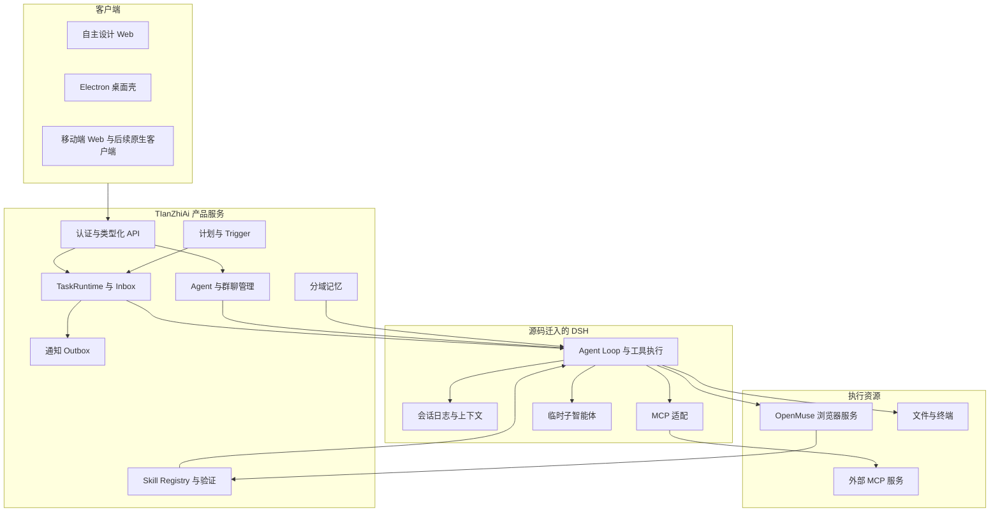

# TIanZhiAi 项目开发规范

本文规定 TIanZhiAi 的产品范围、源码迁移方式、运行架构、数据模型、智能体协作、
浏览器控制、Skill 学习、主动服务、前后端协议和多端交付要求。
开发人员可以据此分阶段实现，并按验收条件判断各阶段是否完成。

日常实施先看根目录的 [总开发计划与顺序记录表](../../总开发计划与进度记录.md)，
按任务编号推进、勾选和交接；Codex 持续协作规则见 [AGENTS.md](../../AGENTS.md)。
本规范负责设计约束，实际完成状态统一在总计划中维护。

| 项目 | 内容 |
| --- | --- |
| 文档版本 | 0.2；2026-10-27 补充 P2 换壳对齐 |
| 编写日期 | 2026-10-26，Asia/Shanghai |
| 产品名称 | TIanZhiAi；代码标识建议统一为 `tianzhiai`，避免大小写造成路径差异 |
| 本地项目目录 | `/Users/zenghao/杭州天智项目/TIanZhiAI` |
| 文档性质 | 持续维护的开发规范；事实、已确认范围与待冻结实现细节分别标注 |
| 当前实现状态 | 已有 P0/P1 与旧 P2 实现；本版新增 P2 换壳需求未实施，状态以总计划为准 |
| 已确认方向 | 源码迁移 DSH 核心；吸收 DS-Bot 思想；接入 OpenMuse 浏览器；P2 迁移 DSH 对话交互并自主设计视觉 |
| 默认开发行为 | 提交说明使用中文；未明确要求时不推送；本文不执行提交或初始化应用 |

配套文件提供可以直接核查的迁移清单和前端参考索引：

- [DSH 源码迁移清单](appendices/DSH源码迁移清单.md)。
- [前端、协议与多端源码参考](appendices/前端协议与多端参考.md)。
- [P2：DSH 换壳对齐需求](appendices/P2-DSH换壳对齐需求.md)。
- [验收场景与需求追踪](appendices/验收场景与需求追踪.md)。
- [上游源码基线](appendices/上游源码基线.json)。
- [DSH 包元数据清单](appendices/DSH包元数据清单.json)。

## 1. 目标与范围

TIanZhiAi 是面向个人的通用助理 Harness。它能持续理解用户的任务和计划，
按需组织专业智能体，通过工具和浏览器完成工作，保存可复用经验，并在适当时间
主动联系用户。产品需要表现出连续的任务执行能力，而非仅提供一次聊天回答。

### 1.1 必须实现的产品能力

以下要求构成首个正式版本的完整范围，具体交付分布在不同阶段。

| 编号 | 要求 | 完成含义 |
| --- | --- | --- |
| FR-CHAT-01 | 持久化聊天与实时执行 | P2 交付 DSH 换壳对话工作区：思考／步骤／工具／沙箱、Composer 与指令、问题审批、会话／工作区、用量和恢复；视觉独立 |
| FR-AGENT-01 | 创建与管理长期智能体 | 用户可管理职责、模型、工具、Skill、记忆与权限配置 |
| FR-AGENT-02 | 临时子智能体 | 为独立子任务创建隔离上下文，结果返回调用者 |
| FR-COLLAB-01 | 多智能体委派 | 保存父子任务、等待关系、结果、失败和取消传播 |
| FR-COLLAB-02 | 群聊协作 | 管理员协调、显式邀请、上下文隔离和可查看任务进展 |
| FR-BROWSER-01 | 通用网站操作 | 从当前页面观察决定动作，支持未知网站探索 |
| FR-BROWSER-02 | 人工接管与归还 | 用户能够实际点击、输入、滚动，并返回原任务继续 |
| FR-BROWSER-03 | 有副作用操作管理 | 绑定具体目标、数据与操作，防止重复提交，保存结果证据 |
| FR-SKILL-01 | Skill 管理 | 支持导入、编辑、版本、作用域、绑定、停用和回滚 |
| FR-SKILL-02 | 网站经验沉淀 | 从有证据的成功片段形成候选 Skill，验证后复用 |
| FR-MCP-01 | MCP 管理 | 支持本地和远程 MCP 接入、发现、凭据与每个 Agent 的工具范围 |
| FR-PROACTIVE-01 | 计划与主动跟进 | 计划可生成持久化触发器，按状态提醒和跟进 |
| FR-MEMORY-01 | 分域长期记忆 | 区分个人、Agent、群聊记忆，支持来源、修改、删除和检索 |
| FR-PLATFORM-01 | 多端共用基础 | Web、桌面、远程连接使用同一核心协议和领域模型 |
| FR-AUDIT-01 | 可核查执行记录 | 用户能查看真实工具、命令、结果、错误与可下载产物 |
| FR-MIGRATE-01 | DSH 源码内迁 | TIanZhiAi 在自身源码和构建链内运行迁入核心 |

### 1.2 第一阶段明确不承诺的能力

这些范围帮助开发人员控制交付边界，不能被产品文案表述为已经支持。

- 不承诺任意网站无需人工介入即可完成交易。
- 不把验证码、银行验证或网站风控限制当成 Harness 可以保证消除的问题。
- 不承诺首次成功即可生成永不失效的自动化流程。
- 不承诺桌面应用完全退出或设备休眠后，本机执行器仍能工作。
- 不在首版同时实现 Android、iOS 原生本机 Agent 执行环境。
- 不直接迁入上游账号体系、付费权益、遥测服务、品牌资源和更新服务器配置。
- 不在内核迁移期间同时重写 Agent Loop、会话格式和全部包名。

### 1.3 两个贯穿全项目的验收样例

每个里程碑都必须推进以下样例，而非仅完成孤立管理页面。

**出行样例**：用户提出网站、路线、时间和偏好。主助理创建任务，出行助手
调用浏览器，首次探索页面，必要时等待用户登录，恢复后准备订单，展示具体确认，
核验实际结果；把成功部分提炼为候选 Skill，换参数重跑并比较效率。

**健身样例**：用户制定训练计划。系统保存计划、时区和提醒偏好，安排训练前提醒，
在次日根据训练记录询问结果。用户改期、暂停或取消后，旧触发不能继续造成提醒。
前端关闭时，在线后端仍能触发并通过已连接消息渠道投递。

## 2. 上游事实与证据边界

本节记录规范依据。它描述编写时所查阅的源码，不代表上游将来版本仍保持相同接口。
精确版本和文件摘要见上游基线 JSON。后续实施必须先重新核对该文件。

### 2.1 本地 DSH 基线

本地参考目录为 `../deepseek-harness`，Git 提交为
`22ddee3792402c3e70ec5f86a63c3e3e895a2f60`，包版本为 `0.2.1-rc.3`。
本次核验的关键事实如下。

- 核心基于 Cordis：模型、工具、会话、循环、权限与界面均通过服务或插件组合。
- 当前 Web 前端使用 React 与 TypeScript/TSX。不得沿用旧资料中的 Vue 判断。
- `SessionEvent` 持久日志是模型历史和执行回放的重要事实来源。
- 前端采用 Connection、Typert Remote、API Gateway、Client Session 对象等层次。
- Web Remote Stream 使用 `/api/remote.mux` WebSocket 多路复用。
- `Session.follow()` 同时交付持久历史和进程内 Assistant 实时呈现帧。
- 桌面壳使用 Electron，复用 Web 页面，并提供 Host 生命周期与平台桥接。
- DSH 的公共 API 处于 pre-stable 阶段；必须锁定版本，不能假定任意插件兼容。

本节主要依据：DSH 的 `docs/architecture.md`、`packages/client/AGENTS.md`、
`packages/api/session-controller/src/types.ts`、
`packages/api/gateway/src/stream-protocol.ts` 和 `apps/desktop/README.md`。

### 2.2 DS-Bot 与 OpenMausBot 基线

DS-Bot 用于长期 Bot、群聊、记忆作用域与派活关系的设计参考。
OpenMausBot 用于统一任务对象、任务树、结果回传、唤醒、恢复和执行证据的设计参考。

| 项目 | 本次查阅提交 | 采用范围 |
| --- | --- | --- |
| DS-Bot | `de55888a93983fc51c94f7d22bc94b4f8293205d` | Bot 身份、群聊、分域记忆、派活树、请求回执 |
| OpenMausBot | `0d8eacc65cd3b783a0d28d019d39e6367780b911` | Assignment、Inbox、事件、恢复、调度与执行器分离 |

DS-Bot 声明测试过 DSH `0.2.1-rc.2`，不能据此认定它与本地 `rc.3` 完全兼容。
本项目采用独立的领域模型和界面，可选择性迁入经评审的实现；不要求整个安装
DS-Bot，也不迁入 OpenMausBot 的整套 CLI 执行引擎。

固定版本参考：

- [DS-Bot 插件说明](https://github.com/Fei2411/DS-Bot/blob/de55888a93983fc51c94f7d22bc94b4f8293205d/ds-bot/README.md)。
- [DS-Bot 派活实现](https://github.com/Fei2411/DS-Bot/blob/de55888a93983fc51c94f7d22bc94b4f8293205d/ds-bot/src/host/handoffs.js)。
- [DS-Bot 请求去重](https://github.com/Fei2411/DS-Bot/blob/de55888a93983fc51c94f7d22bc94b4f8293205d/ds-bot/src/host/requests.js)。
- [OpenMausBot 任务规范](https://github.com/milind-soni/OpenMausBot/blob/0d8eacc65cd3b783a0d28d019d39e6367780b911/docs/runtime-contract.md)。
- [OpenMausBot 任务实现](https://github.com/milind-soni/OpenMausBot/blob/0d8eacc65cd3b783a0d28d019d39e6367780b911/server/runtime/runtime.ts)。

### 2.3 本地 OpenMuse 基线

本地参考目录为 `../OpenMuse`，Git 提交为
`4d275e6b2c4b7dadd5ad14d0399313423d5cae33`。
编写时 `apps/worker/src/browser.ts` 和 `apps/worker/tests/lifecycle.test.ts`
存在未提交改动。迁移前必须分别保存已提交基线和工作区差异，评审后决定纳入范围。
不得把该提交号当成当前工作区所有文件内容的完整标识。

已经观察到的实现包括：页面文字和可见控件观察、截图辅助、快照引用检查、
浏览器会话、人工控制、操作 Reviewer、订单确认与结果核验。
服务端 `BookingService`、`BrowserService` 与 Worker 共同组成该能力，
仅迁移 Worker 不满足本规范。

### 2.4 现状、约束与拟议设计的区分

全文中“必须”是 TIanZhiAi 的实现与验收要求；“建议”是可经 ADR 调整的选择。
未特别标注为上游现状的 TIanZhiAi 数据表、接口、命令、配置和目录，均为拟议设计。
文中的将来测试清单不表示这些测试本次已经运行。

## 3. 总体架构与职责

系统划分为客户端、产品服务、Agent 运行时和执行资源四层。
一项任务的生命周期由产品任务运行时管理，模型推理与工具循环由迁入的 DSH 管理。



### 3.1 状态的唯一所有者

每类状态必须有明确所有者。页面状态和缓存不能成为新的业务事实来源。

| 状态 | 权威来源 | 派生视图 |
| --- | --- | --- |
| 模型历史、工具调用与结果 | DSH Session 日志 | 聊天、轨迹、用量 |
| 长期 Agent 定义 | 产品数据库的版本化定义 | Agent 卡片、可分派列表 |
| 跨 Agent 任务与父子关系 | TaskRuntime 数据库 | 看板、群聊状态、等待提示 |
| 浏览器生命周期与控制权 | BrowserService 与 Worker 受租约管理的状态 | 预览、接管按钮 |
| 订单及未知操作结果 | 浏览器事务记录与外部可核查证据 | 订单卡片、核验提示 |
| Skill 生效版本 | Skill Registry | 已安装能力、Agent 绑定 |
| 提醒时间与发生记录 | Scheduler 数据表 | 日历、下次执行时间 |
| 通知投递结果 | Notification Outbox 与渠道回执 | 通知中心 |
| 草稿、选中项、面板尺寸 | 客户端交互 Store | 当前设备界面 |

DSH 会话内回合状态和产品 Task 状态具有不同含义。例如，模型一个回合已经 idle，
产品任务仍可能处于 `waiting_children`。不得用一个 `isLoading` 同时表示两者。

### 3.2 进程与部署模式

首版实现以下三种模式，共用协议与模型。

1. **本机桌面**：Electron 启动独立 Runtime Host，浏览器 Worker 独立进程运行。
2. **本机 Web**：Node Host 提供 API 与静态页面；浏览器访问同一服务。
3. **远程服务**：Linux Host 常驻，客户端经过认证连接；浏览器 Worker 可容器化。

产品服务与 DSH 初期可以运行在同一 Host 进程内，通过 Cordis 服务通信，
保留 EngineAdapter 接口。浏览器 Worker 必须隔离，避免 Chromium 崩溃拖垮任务服务。
需要多进程扩展时，TaskRuntime 通过持久化租约接管，不把 Cordis 内存事件当消息队列。

## 4. 源码迁移策略

本项目选择 DSH 源码内迁。源码、构建、运行与发布都必须归属 TIanZhiAi，
长期运行不依赖用户另行安装的 DSH，也不依赖同级开发目录。

### 4.1 迁移原则

开发人员必须遵守以下迁移约束。

- 锁定上游提交；保留源码来源、许可文件、修改记录和本地补丁清单。
- 首批保留 `packages/<group>/<package>` 与 `vendor/*` 结构，减少相对配置路径破坏。
- 首批保留上游内部包名 `@deepseek-ai/dsh-*`，产品新增包使用 `@tianzhiai/*`。
- 保持单份 Cordis、React、协议注册器与依赖注入身份，防止双实例。
- 先迁服务定义、提供者、消费者和必要构建链，再裁剪配置；不能只复制循环文件。
- 迁入源码不等于启用全部能力，启用范围由 TIanZhiAi Profile 显式声明。
- 迁入上游测试与回放 fixture；不能以“能聊天”替代恢复与工具行为验收。
- 尽量通过新插件改变产品行为；修改 Loop 和 Session 核心必须有 ADR 与回归证据。
- 不混合两个版本的同名核心包；迁移阶段统一使用同一个基线。

### 4.2 “核心”包含的实际范围

本规范的核心至少包含以下相互配合的模块，详见迁移清单。

| 层次 | 上游位置 | 迁移理由 |
| --- | --- | --- |
| 插件基础 | `vendor/`、`packages/util/` | 服务、事件、Loader、Schema、取消与底层工具 |
| 推理循环 | `packages/core/`、`packages/llm/` | 模型流、工具执行、上下文组装、Agent 生命周期 |
| 持久会话 | `packages/session/`、`packages/storage/` | 日志、格式解码、恢复、投影、版本迁移 |
| 上下文 | `packages/compaction/`、`packages/context/`、`packages/spill/` | 历史裁剪、图像卸载、上下文约束与输出溢出 |
| 能力 | `packages/skill/`、`packages/mcp/`、`packages/preset/` | 加载可复用能力，定义不同 Agent 组合 |
| 协作 | `packages/subagent/`、`packages/jobs/` | 临时子智能体、后台工具任务和取消 |
| 操作基础 | `packages/fs/`、`packages/shell/`、`packages/subprocess/`、`packages/sandbox/` | 文件、命令、隔离、进程清理 |
| 用户交互 | `packages/interaction/`、`packages/credentials/` | 问题、审批、权限、凭据引用 |
| 协议 | `packages/typert/`、`packages/api/`、`packages/client/connection/` | 类型化调用、认证、流、恢复 |
| 启动发布 | `packages/boot/`、`packages/bundle/`、`apps/cli/`、必要 `scripts/` | 可重复组合、构建与正式运行入口 |

`native/system` 与其平台包必须进入依赖审计。是否随某一发行版打包，以该发行版
真实启用的文件、终端、进程和 Sandbox 提供者为依据，不能因其不是 TypeScript 就遗漏。

### 4.3 建议目标目录

以下为开发目标结构，不表示当前目录已经具备这些内容。

```text
TIanZhiAI/
  apps/
    cli/                         # 迁入并产品化的统一 Profile 启动器
    tianzhiai-web/                # 自主设计的 Web 入口
    tianzhiai-desktop/            # Electron 壳
    browser-worker/              # 从 OpenMuse 抽取的独立浏览器执行器
  packages/
    core/ llm/ session/ storage/  # 按原布局迁入的 DSH 包
    typert/ api/ client/ ...      # 按需迁入的协议、状态与参考组件
    product/
      domain/                    # 浏览器安全的产品类型
      database/                  # 业务数据库与迁移
      agent-directory/           # 长期 Agent 定义和版本
      task-runtime/              # 父子任务、Inbox、租约、唤醒
      engine-adapter/            # TaskRuntime 到 DSH 的适配
      groups/ memory/ plans/     # 群聊、长期记忆、个人计划
      scheduler/ notifications/  # 时间与事件触发、投递
      browser-service/           # 会话、控制权、操作与事务
      browser-tools/             # DSH 工具注册
      skill-registry/            # 产品级 Skill 元数据与版本
      skill-learning/            # 轨迹提炼、验证与回滚
      mcp-management/            # MCP 配置、凭据引用和工具范围
      api/                       # 类型化产品 API
      client-models/             # React-free 产品状态对象
      ui-kit/                    # 参考 DSH 开发的基础组件
      platform/                  # 平台能力接口
  vendor/                        # 单份 Cordis 等必要 vendored 依赖
  native/system/                 # 按依赖闭包迁入的本地能力
  profiles/                      # TIanZhiAi 产品组合配置
  scripts/                       # 迁移校验、构建、打包、发布
  tests/fixtures/                 # 跨层回放与假服务
  docs/specs/                    # 本规范和附录
```

不新增第二套 `node_modules` 来承载另一版本的核心。源码参考快照若单独归档，
必须排除在 workspace 和发布产物之外，防止重复依赖与包名冲突。

### 4.4 依赖闭包与启动配置

迁移包集合必须同时覆盖以下来源，单看 `package.json.dependencies` 不充分。

1. 包的运行依赖、共享身份的 Peer 依赖。
2. 类型和构建依赖，包括 Typert 生成器和 TS project references。
3. Cordis Profile／Bundle／Preset 中按字符串引用的插件。
4. Native addon、Worker、子进程入口、动态 import、资源和 fixture。
5. 客户端静态模块表与 `dsh.client` 元数据中的共享模块。

每个批次输出：选定种子包、闭包清单、尚未解析的引用、启用插件树、构建结果和测试结果。
附录中的闭包结果仅是静态候选，不能宣称为最终最小可发布集合。

新 Profile 必须延续 DSH 的“统一启动器 → Profile → Bundle/Patch → 插件树”方式。
上游 `sdk-minimal` 可参考最小组合结构，其默认权限、品牌和模型参数不能原样作为
TIanZhiAi 产品默认值。

### 4.5 分批迁移程序

每批按相同流程实施，保证问题可以定位到明确范围。

1. 冻结上游版本并生成文件摘要，单独保存需要纳入的工作区差异。
2. 选择本批能力和验收样例，枚举服务定义／提供者／消费者。
3. 计算并人工检查依赖闭包，迁入源码、配置、类型生成与必要测试。
4. 保持核心行为不变，完成本项目内的干净安装与构建。
5. 从本项目 Profile 启动，使用假模型／假工具执行关键场景。
6. 与锁定上游比较事件语义、模型可见内容、错误、取消和恢复。
7. 再进行 TIanZhiAi 适配，运行对应回归，记录差异。
8. 确认发布产物不引用 `../deepseek-harness`、`../OpenMuse` 或开发绝对路径。
9. 更新迁移状态、来源清单和回滚说明，才进入下一批。

上游仓库只能作为只读来源。迁移不得覆盖用户在 OpenMuse 中的现有修改。

### 4.6 迁移完成条件与回滚

一个模块只有同时满足以下条件，状态才能从 `adapted` 变为 `accepted`。

- 本仓库可解析所有运行与构建依赖。
- 必要生成物可从源码重新生成，Native 与 Worker 入口可用。
- 服务生命周期、取消、dispose、故障恢复和模型可见内容有对应证据。
- 开发目录之外的已安装产物可启动。
- 原始来源、版本、许可和本地修改可追踪。
- 回滚可以恢复旧程序与兼容数据；不通过覆盖新数据库伪造回滚成功。

初期状态建议为 `planned → imported → buildable → adapted → accepted`。
另设 `reference_only`、`deferred` 和 `excluded`，避免“文件已复制”被算成能力完成。

## 5. Agent 执行内核

TIanZhiAi 保留 DSH 原有单 Agent 循环，通过产品插件和 EngineAdapter 组织任务。
本节定义每项执行必须遵守的行为。

### 5.1 一次执行的输入与输出

任务运行时必须把目标、必要上下文、能力范围和结果要求交给 EngineAdapter。
以下类型是拟议接口，不是上游现成 API。

```ts
interface EngineRunRequest {
  taskId: string;
  executionId: string;
  agentDefinitionId: string;
  agentDefinitionVersion: number;
  sessionBindingId: string;
  prompt: string;
  contextRefs: readonly string[];
  capabilitySnapshotId: string;
  authorizationSnapshotId: string;
  signal: AbortSignal;
}

type EngineRunOutcome =
  | { kind: 'completed'; resultRef: string; evidenceRefs: string[] }
  | { kind: 'waiting-user'; interactionId: string }
  | { kind: 'waiting-children'; childTaskIds: string[] }
  | { kind: 'continuation'; checkpointRef: string }
  | { kind: 'cancelled'; reason: string }
  | { kind: 'failed'; code: string; detailRef?: string };
```

EngineAdapter 负责 DSH 会话创建／恢复、工具范围挂载、事件订阅、取消与清理。
它不能直接修改 TaskRuntime 数据表，也不能把 Assistant 自述直接映射为任务成功。

### 5.2 模型、上下文和工具

每个执行保存模型选择和能力版本，后续可重建当时的行为环境。

- 模型配置使用供应商、模型 ID、能力信息和 `credentialRef`；密钥不进入定义正文。
- 主助理与浏览器角色允许不同模型；图像能力按实际模型路由检查。
- 对话压缩、旧工具结果裁剪和图像卸载各有独立策略。
- 页面历史保留目标、当前状态与必要证据，避免每步累积全量 DOM 和截图。
- 历史日志保留可审计事实，模型上下文通过投影与压缩控制大小。
- 工具发现与加载可以渐进展开，但执行层仍检查最终工具名与权限。
- 副作用工具不自动享有幂等性；重试由该工具的具体语义决定。

### 5.3 日志与生命周期

迁移时必须保留 `turn/start`、`step/start`、`request/*`、`assistant/*`、
`tool/call`、`tool/result`、`step/end` 和 `turn/end` 的一致性。
新增模型可见输入必须可从日志重建。流式取消保留用户已见的文本，并区分中断和完成。

每个 Agent Handle 有唯一所有者。取消负责停止新工作，dispose 负责完成资源清理。
工具、注册器、MCP 连接、子进程和浏览器租约均必须说明由谁创建、关闭和恢复。

## 6. 长期 Agent 与管理

产品中的 AgentDefinition 表示稳定身份和配置，AgentExecution 表示某次运行，
SessionBinding 表示该身份在某个会话场景中的 DSH Session。三者不能混用。

### 6.1 Agent 定义

建议保存以下字段，并让每次修改生成新版本。

| 字段 | 含义与约束 |
| --- | --- |
| `id`, `ownerId`, `version` | 身份、用户归属和单调版本 |
| `name`, `description`, `avatarRef` | 展示信息，不决定权限 |
| `roleInstructions` | 职责、任务边界与输出要求 |
| `modelConfigId` | 模型路由引用 |
| `presetId` | 可审计的插件组合模板 |
| `toolBindings` | 允许的工具及服务侧约束 |
| `skillBindings` | Skill ID、绑定版本策略与作用域 |
| `mcpBindings` | MCP 连接和工具范围引用 |
| `memoryPolicy` | 允许读写的记忆作用域 |
| `delegationPolicy` | 可委派角色、并发与预算 |
| `workspacePolicy` | 工作目录及文件范围 |
| `browserPolicy` | 浏览器配置与账号范围引用 |
| `notificationPolicy` | 可联系用户的场景与渠道范围 |
| `status` | `active`、`disabled`、`archived` |

用户输入的定义必须是受校验的配置数据。普通 Agent 编辑器不直接接受能执行 Host
代码的 Cordis YAML、插件 JavaScript 或任意环境变量；高级本地插件另走明确安装流程。

### 6.2 管理操作

Agent 管理至少提供以下操作。

- 创建、复制、编辑、停用、归档、恢复与导出。
- 预览生效提示词、模型、Skill、工具和权限摘要。
- 查看当前运行、等待事项、历史任务和用量。
- 设置 Chief；首版建议一个默认 Chief，但数据模型允许多个被明确授权的协调角色。
- 选择版本更新对“新任务”生效，现有执行继续使用快照。
- 权限撤销即时影响尚未执行的操作；定义快照不能让已撤销授权继续有效。

复制 Agent 不复制密钥、用户批准、网站登录会话或待执行交易。
删除／归档前展示仍在运行的任务、未来触发器与浏览器资源，按明确策略处理。

### 6.3 长期与临时 Agent 的协同

长期助手通过持久化任务被唤醒；临时子智能体通过 DSH spawn/fork 执行独立子任务。
会跨重启、等待人工或要求可追踪结果的委派，必须进入 TaskRuntime。
同一委派不能同时由 DSH 子智能体树和产品任务树各自创建一次。

EngineAdapter 记录两类树的映射。临时子智能体事件属于当前 TaskExecution 的证据；
只有显式提升为持久任务后，才拥有独立 Task 状态与恢复策略。

## 7. 多智能体任务运行时

TaskRuntime 是产品级协作控制中心。它统一处理用户、定时器、事件和其他 Agent 发起
的工作，保存任务接受、调度、等待、恢复和结算结果。

### 7.1 任务模型

每个 Task 至少包含下列字段。

```ts
interface Task {
  id: string;
  ownerId: string;
  rootTaskId: string;
  parentTaskId?: string;
  requester: { kind: 'user' | 'agent' | 'trigger'; id: string };
  assigneeAgentId: string;
  origin: 'user' | 'schedule' | 'webhook' | 'app-event' | 'agent';
  mode: 'work' | 'consult' | 'notify';
  goal: string;
  doneWhen: string;
  inputRefs: string[];
  authorizationRef: string;
  definitionVersion: number;
  status: TaskStatus;
  revision: number;
  resultRef?: string;
  evidenceRefs: string[];
  nextRunAt?: string;
  leaseOwner?: string;
  leaseToken?: string;
  leaseUntil?: string;
}
```

`doneWhen` 是验收目标的数据描述，不能作为绕过网站或工具授权的指令。
`consult` 默认不能执行外部写入；`notify` 不创建等待其结果的父子阻塞关系。

### 7.2 状态机

任务状态和合法变更如下。每次变更都递增 revision，并写入 TaskEvent。

| 状态 | 含义 | 主要后继 |
| --- | --- | --- |
| `created` | 已保存但未排队 | `queued`, `cancelled` |
| `queued` | 等待资源和执行资格 | `running`, `paused`, `cancelled` |
| `running` | 某 Execution 正在持有租约 | 等待态、暂停态或终态 |
| `waiting_children` | 等待子任务 | `queued`, `paused`, `cancelled` |
| `waiting_user` | 等待事实输入或人工操作 | `queued`, `paused`, `cancelled` |
| `waiting_approval` | 等待明确操作批准 | `queued`, `failed`, `cancelled` |
| `paused` | 用户或策略暂停 | `queued`, `cancelled` |
| `needs_reconciliation` | 外部效果不确定 | `queued`, `succeeded`, `failed`, `cancelled` |
| `succeeded` | 有可核查结果的成功 | 无；返工创建新执行任务 |
| `failed` | 明确失败 | 无；重试创建有来源关联的新任务 |
| `cancelled` | 停止继续执行 | 无；不等于外部订单已取消 |

批准超时不能转换为批准；关闭前端不能转换为任务取消；Agent 回合结束不能自动
把 `waiting_children` 转为成功。外部结果未知时，仅允许核验或人工处理分支。

### 7.3 派活、回传与唤醒

任务调度遵循下面的顺序。

1. 校验请求方、接收方、任务来源与权限范围。
2. 检查请求幂等键、父任务状态、环路、并发与预算。
3. 在事务中保存 Task、TaskEvent 和调度意图。
4. 提交后获取执行资源，创建带 fencing token 的 Execution。
5. 子任务结算后，在事务中保存结果引用与父任务 Inbox。
6. 父任务可运行且未取消时，合并尚未消费结果并唤醒一次。
7. 父任务确认消费某个 Inbox 项后写回消费位置。

结果在数据库提交前不能对外宣布完成。唤醒采用至少一次投递和消费去重，
不能宣称对任意外部系统实现 exactly-once。

### 7.4 防环路与预算

同一任务树中，正在等待当前工作结果的上游不能再次成为被委派者。
正常的结果返回由调度层完成，不要求模型发新消息回上游。
返工明确创建新一轮，并关联原任务与评审结果。

预算至少覆盖：并发 Execution、任务树深度、模型 Token、工具调用、运行成本上限、
连续无进展轮次和重复错误。初始数值通过配置及验收集确定，不写死在提示词里。
等待用户的时间不按模型执行时间收费，也不因为用户迟迟未答而自动增加授权。

### 7.5 租约、重复消息与恢复

任务请求必须有调用方作用域内唯一的 `requestId`，并记录规范化参数摘要。
同键同内容返回原回执；同键不同内容返回冲突；结果不确定时返回明确未知状态。

Execution 使用数据库租约与 fencing token。旧 Worker 即使继续运行，其后续写入和
操作请求也必须被拒绝。Heartbeat 在这里表示租约续期，不能与主动关怀混为一谈。

重启恢复必须分类处理：

| 中断前情况 | 恢复行为 |
| --- | --- |
| 已排队未执行 | 保留请求，重新参与调度 |
| 只读执行中断 | 按检查点恢复或明确重新执行 |
| 已派出子任务 | 恢复等待关系，不重复派活 |
| 等待用户或批准 | 重建交互卡片，等待原交互结果 |
| 有外部提交意图或效果未知 | 进入核验，禁止盲目重放 |
| 已终结但未回传 | 补投 Inbox，保持结果去重 |
| 已取消 | 拒绝迟到结果唤醒任务；保存事实用于审计 |

进程崩溃可能发生在“网站已受理、回执尚未落库”的间隙。因此，即使数据库没有
成功回执，也不能推断外部操作没有发生。

## 8. 群聊与上下文

群聊是用户可见的协作场景，实际执行仍进入统一 TaskRuntime。
群消息、私聊消息和任务结果属于不同类型，不用自由文本猜测它们的关系。

### 8.1 群聊基本规则

群聊保存成员、管理员、工作目录、记忆范围和默认响应策略。
默认由管理员处理用户消息；被明确 `@` 的成员响应；有独立任务时可并行执行，
群内发言按序发布，避免成员对同一个旧上下文同时回复。

- 用户可以查看谁在执行、等谁、等待什么输入、已经消耗多少预算。
- 成员只读自己有权限的群和引用内容。
- 每个成员在每个群有独立 SessionBinding。
- 群记忆不会自动写入成员私聊记忆。
- 群级工作目录和工具范围不得扩大成员未获得的授权。
- 无新增信息时允许成员保持安静，不生成确认与感谢的无限回声。

### 8.2 上下文交接

交接包包含目标、用户原始约束、已完成步骤、关键证据、当前等待、未决事项和结果格式。
来源由 Host 写入结构化字段；其他 Agent 的文字不能冒充用户指令。

优先传有界摘要与证据引用，必要时按需读取原文。工具结果、网页、文件与其他 Agent
的发言均作为数据。转交任务不能获得修改权限、批准支付或安装任意插件的能力。

### 8.3 长对话与分段

首版延续 DSH 压缩策略，产品通过 SessionBinding 保存长期身份。
DS-Bot 的 Context Steward 与分段交接机制列为后续可选迁入项。
若启用分段，必须先解决提醒绑定迁移、未消费 Inbox、附件引用、搜索索引和运行中任务
的归属，不能只换一个 Session ID。

## 9. 浏览器能力迁移与接管

浏览器子系统从 OpenMuse 抽取，提供受任务约束的通用浏览器操作。
浏览器 Agent 负责决定下一步，服务负责检查当前证据、控制权与允许执行的动作。

### 9.1 必须迁移的组成

迁移范围如下，各层必须通过新接口明确解耦。

| 来源 | 目标职责 | 必须适配 |
| --- | --- | --- |
| `apps/worker/src/browser.ts` | 浏览器／Profile 生命周期 | 资源上限、持久化位置、租约与跨平台启动 |
| `apps/worker/src/browser-agent.ts` | 观察与受检动作 | Task／Execution 标识、策略、取消和证据 |
| `page-dom.ts` | 可见文字、Frame、Shadow DOM 与视觉点解析 | 继续验证当前控件 |
| `server.ts`、`network.ts`、`proxy.ts` | Worker 通信与出口约束 | 身份、短期请求授权、错误与超时 |
| `apps/server/src/browser.ts` | BrowserService | 产品数据库、文件服务、认证和控制权 |
| `apps/server/src/booking/service.ts` | 任务与事务状态 | 抽出通用 BrowserTask／BrowserTransaction |
| `booking/reviewer.ts` | 当前操作语义评估 | 模型调用改走 DSH 适配与用量记录 |
| `booking/tools.ts` | 模型可见工具 | 从 CopilotKit 定义转换为 DSH 工具注册 |
| `browser-console.ts` | 人工操作界面及输入流 | 自主界面、真实输入、缩放和跨端适配 |
| `packages/domain/src/booking.ts` | 输入／观察／事务类型 | 产品命名、版本、敏感字段与兼容性 |

不迁入 OpenMuse 的 TanStack Agent Loop 作为第二执行循环。
已有测试必须按职责迁入，网站流程只作为有授权范围的验收目标。

### 9.2 浏览器资源模型

资源状态至少拆成三个维度，避免一个大枚举混合不同含义。

- 生命周期：`starting`、`open`、`closing`、`closed`、`error`。
- 控制权：`agent`、`human`、`none`，另有单调 `controlEpoch`。
- 事务：`none`、`prepared`、`awaiting_confirmation`、`submitted`、
  `pending`、`succeeded`、`failed`、`unknown`。

BrowserSession 关联 owner、任务、Execution、Profile、Worker 和租约。
用户、Agent、会话、浏览器 Profile 与网站账号是不同身份，不允许按显示名称关联。
同一可变网页上下文在同一时间只能有一个控制者。

### 9.3 观察与动作协议

观察结果保留当前快照、URL、标题、可见文字、控件语义、Frame、页面 ID、截断和
加载信息。截图作为附件引用提供，不在产品任务行中累计保存巨大的 Base64。

动作至少支持观察、导航、等待、截图、视觉点检查、滚动、点击、填写、选择、勾选、
受限按键与切换页面。所有可变动作验证：

1. owner、Task 和 Execution 仍有效。
2. 租约、控制者及 `controlEpoch` 匹配。
3. 当前快照与目标引用仍有效，控件可见且签名一致。
4. 操作语义与当前授权范围匹配。
5. 敏感或外部提交动作具备适用的、未过期的具体批准。
6. 同一不可重复操作没有已经执行或未知的记录。

模型根据页面上下文判断操作的立即效果；Worker 校验证据和状态。
不得仅凭价格、按钮单词、`/checkout` 路径或验证码 iframe 判断最终交易。

### 9.4 人工接管

接管必须是能输入的真实控制界面。静态截图和只读视频不能算接管完成。

1. 用户提交带资源版本的接管请求。
2. 服务提升 `controlEpoch`，停止接受旧 Agent 动作并通知 Agent 暂停。
3. 对已经发送但未确认的动作进行状态记录，不能假定撤销成功。
4. 用户实际点击、输入、滚动；输入标明当前浏览器、控制代次与序号。
5. 画面变化、缩放和 viewport 使用一致的 CSS 像素坐标映射。
6. 用户明确归还控制；服务再次提升 epoch，Agent 重新观察当前页面。
7. 从真实当前状态继续原任务，旧快照、旧评估和旧目标引用全部失效。

接管断线后默认保持暂停或人控状态，不因超时自动抢回控制。
多个设备争抢控制通过 compare-and-swap 处理，只有一个请求成功。
不确定是否已送达的人工输入不能自动重放。

### 9.5 订单与副作用

具体交易绑定网站、商户、行程／商品、用户数据范围、金额、币种、条款和目标控件。
任何关键字段变化都必须让原批准失效。订单提交、支付和出票是不同事实。

- 用户在经过认证的界面操作，生成审批事件；模型不能调用工具替自己批准。
- 提交前持久保存操作意图和幂等身份；提交后尽快保存回执及证据。
- 超时或浏览器崩溃后进入 `unknown`，通过只读订单查询核验。
- 支付成功必须有订单与金额等证据；点击成功不代表支付或出票成功。
- 关闭浏览器只释放资源，不代表取消订单或退款。
- 浏览器 Skill、脚本和批量操作必须走相同网关，不能获得旁路 Playwright/CDP 权限。

### 9.6 本机与远程浏览器

执行器实现可替换，但任务、控制权和事务接口保持一致。
首版优先复用 OpenMuse Worker；DSH 的实验浏览器适配器作为对照测试来源。
默认 Profile 每次只挂载一个浏览器 provider，遵循当前 DSH browser-use 注册约束。

远程 Worker 可在 Linux 容器运行；本机 Worker 使用应用管理的 Chromium 依赖。
BrowserProfile 的 Cookie 和存储数据按账号隔离并加密存储，不写入 Skill 或普通记忆。
浏览器进程退出不意味着 Session 对话丢失，恢复对话也不意味着网页状态已恢复。

## 10. Skill 管理与学习

产品 Skill 层在 DSH 加载机制之上管理版本、适用范围、验证结果和执行质量。
它保存可复用程序性知识，不修改基础模型权重。

### 10.1 Skill 包结构

采用可兼容 Agent Skills 的目录结构，并增加产品元数据。

```text
railway-search/
  SKILL.md
  references/
    site-notes.md
  workflows/
    search-trains.json
  scripts/
    search-trains.ts             # 仅在确有需要时提供
  evaluations/
    cases.json
  tianzhiai.manifest.json
```

`SKILL.md` 保留标准 name／description 和操作知识；产品扩展字段放 manifest。
脚本是能力受限的执行资产，不是 Agent 可以任意执行 Host 代码的通行证。

### 10.2 元数据与版本

SkillVersion 至少保存以下信息。

- ID、版本、包摘要、作者或生成来源。
- 作用域：个人、某个 Agent、群聊或明确共享范围。
- 输入与输出 Schema、需要的工具和浏览器能力。
- 适用网站、页面条件、语言、登录条件与兼容版本。
- 学习任务、原始轨迹与证据引用。
- 风险类别、批准策略与凭据引用要求。
- 验证状态、测试案例、成功／失败计数及上次验证时间。
- 替代版本、停用原因与回滚关系。

版本不可原地覆盖；用户编辑形成新版本。执行记录锁定实际使用版本，
已有历史不因更新而改变。生效状态为 `draft → validating → active`，
另设 `rejected`、`quarantined`、`deprecated`、`disabled`。

### 10.3 探索到学习的流水线

学习任务在原任务获得可核查结果后异步执行，不能阻塞结果通知。

1. 从轨迹选出有证据的成功片段，标记完整成功或部分成功范围。
2. 删除凭据、个人值和无关页面信息。
3. 提取输入参数、前置条件、动作语义和后置条件。
4. 删除失败绕路，保留有用异常处理与恢复规则。
5. 生成候选说明和可执行流程；为每个自动化片段记录证据。
6. 静态检查结构、权限、依赖、敏感信息和禁用旁路。
7. 在受控测试环境重跑；验证未覆盖真实交易时不得标为交易能力已验证。
8. 通过后启用低风险范围；高影响动作继续按每次任务确认。

自动学习不是自动信任：网页文字不能让系统把其指令保存为高级权限 Skill。

### 10.4 流程表达与复用

拟议工作流节点采用有限动作与状态断言，以下仅为格式示例。

```json
{
  "schemaVersion": 1,
  "id": "search-trains",
  "inputs": ["origin", "destination", "departureDate"],
  "steps": [
    {"id": "open", "kind": "navigate", "target": "site-home"},
    {"id": "form", "kind": "assert-state", "state": "search-form-visible"},
    {"id": "fill", "kind": "action-group", "operation": "fill-search-fields"},
    {"id": "results", "kind": "assert-state", "state": "matching-route-visible"}
  ],
  "onMismatch": "pause-and-explore",
  "completion": "verified-search-results"
}
```

语义定位必须解析成当次快照的真实目标。不得保存旧 snapshotId、ref 或屏幕绝对坐标
作为永久路径。批量动作内部仍逐动作检查当前状态与授权。

复用优先级为：适用的已验证流程 → 当前页面可用的语义操作 → 模型探索 → 人工接管。
流程不匹配时停在已验证检查点；外部操作未知时进入核验，不直接回退成重新提交。

### 10.5 管理与质量指标

用户可以查看来源、验证范围、历史版本、引用它的 Agent、停用和回滚。
Skill 检索先加载摘要，再按需加载正文与引用。工具和 Skill 列表不能无限塞进系统提示。

效率指标分别记录网页动作次数、Actor 模型调用、Reviewer 模型调用、Token、耗时、
成功率、人工接管率与失效回退率。禁止把模型调用减少直接写成点击次数减少，
也不得未经实测套用第三方性能倍数。

## 11. MCP 与能力管理

MCP 连接提供外部工具；Skill 指导如何使用能力；AgentDefinition 选择可用能力。
三类对象分别管理，避免导入一个 Skill 就隐式启动任意本地命令。

### 11.1 连接配置

每个 MCPConnection 保存 transport、地址或受审命令、环境变量引用、凭据引用、
工具范围、连接状态、版本和健康信息。首版覆盖 DSH 当前支持的 stdio 与
Streamable HTTP。其他协议功能必须按实际适配与测试说明支持状态。

- 发现工具后保留原始 Schema 摘要和稳定 server/tool 标识。
- 每个 Agent 绑定工具范围；执行时校验，而非只从界面隐藏。
- 每个连接有启动、发现、调用、取消和关闭的超时与错误归属。
- 导入本地命令需要明确安装／执行授权，远程服务器内容不能授权本地命令。
- 凭据留在 Host，客户端只能看到配置引用和掩码。
- 有连接失败时显示真实不可用状态，不伪造空结果或静默切换其他服务。

### 11.2 渐进发现与通用工具网关

可以参考 OpenMausBot 的 `find_tool`／`use_tool` 模式减少上下文，
但权限和审计必须针对内部实际工具名。审批、发送、支付等需要精确关联的工具，
不得因包裹成通用调用而失去原本的检查。

初期建议直接迁入 DSH MCP Client，再增加产品连接目录和 Agent 绑定。
MCP prompts、订阅、音频、task extension 等功能按锁定版本现状逐项标记，
不能用“MCP compatible”笼统表示所有功能都支持。

## 12. 记忆、计划和主动服务

主动服务是可追踪的计划执行能力。调度器决定何时触发，Agent 决定该说什么，
消息服务负责真正送达，用户反馈改变后续计划。

### 12.1 记忆作用域

记忆至少区分个人、Agent 和群聊作用域，保存来源、时间、作者、版本及可删除状态。
敏感凭据使用独立凭据系统；页面和工具输出不会自动成为用户长期偏好。

记忆读取按当前任务授权范围过滤。用户可以查看、纠正、删除和撤销共享。
记忆更新与模型上下文快照分开管理：新记忆对以后查询生效，历史输入保留当时证据。

### 12.2 Plan 与 Trigger

Plan 保存用户的长期目标、周期、状态、里程碑、默认 Agent、提醒偏好与版本。
Trigger 保存具体触发条件，Occurrence 保存某次实际发生，三者分别持久化。

| 对象 | 核心字段 |
| --- | --- |
| Plan | owner、title、version、timezone、status、目标与执行记录 |
| Trigger | planId、planVersion、schedule/event、agentId、policy、nextRunAt |
| Occurrence | triggerId、计划发生时间、去重键、TaskId、状态与处理结果 |
| FollowUp | sourceTask/occurrence、等待条件、最早联系时间、取消条件 |

时区使用 IANA 名称并明确保存；日历时间与 UTC 执行时间分别处理。
改期、暂停和取消必须让旧版本未来 Occurrence 失效；已经发生的历史不删除。

### 12.3 触发类型

首版调度支持一次性、周期、每日、每周与 Cron；事件入口后续支持 Webhook 与
已授权应用事件。周期状态检查可表达为普通 Trigger，不额外维护另一套隐式心跳任务。

调度扫描不调用模型。满足规则且需要语义判断时才创建 Task。
每个 Occurrence 使用确定性去重身份，重启与多 Worker 不重复创建同一任务。
慢任务默认不累积无限同类队列；跳过、合并和延迟策略明确展示。

DSH Schedule 作为迁移参考或初期引擎提醒能力，不与产品 Scheduler 同时拥有同一
业务计划。迁入主动服务后，由产品调度器统一创建任务，避免双重提醒。

### 12.4 健身跟进规则

健身样例要求实现以下分支。

- 训练前按用户设定提前量提醒，包含当前有效计划。
- 已取消或改期时不发送旧提醒。
- 次日已有训练记录时围绕成果、恢复情况跟进。
- 没有训练记录时询问是否按计划完成，不假定用户已经训练。
- 用户暂不想被打扰时暂停该跟进或修改频率。
- 近期已经询问且用户未答时，按通知策略合并或保持安静。

### 12.5 消息投递与在线边界

通知使用 Outbox：业务事务保存待投递事件，独立发送器处理渠道、重试与回执。
至少保存待发送、发送中、已接受、明确失败、结果未知和已读状态。
渠道“接受消息”不等于用户已读；UI 显示必须区分。

首版实现站内消息；随后接入桌面系统通知与一个实际可达的远程消息渠道。
浏览器 WebSocket 或轮询无法保证页面关闭后的通知。Web Push／移动 Push 需要相应
权限、订阅和平台服务，作为独立可验收能力。

部署界面必须显示执行 Host 是否在线。桌面窗口关闭、应用退出、系统休眠和远程
服务持续运行是不同状态。常驻后台服务、开机自启等系统设置由用户明确启用。

## 13. 前后端协议与状态同步

新前端必须延续 DSH 已有协议的语义和类型边界。视觉层可以重新设计，
发送、排队、实时流、恢复、审批和结果呈现不能简化成一个通用聊天接口。

### 13.1 协议分层

协议采用以下四层，详细源文件见前端附录。

1. **载体层**：Web HTTP/WebSocket；Desktop 受控 IPC／Host bridge。
2. **Connection 层**：连接代次、认证、RPC 关联、重连与取消。
3. **Typert Remote 层**：生成的方法类型、Schema、序列化与流调用。
4. **领域层**：Session、Agent、Task、Browser、Skill、Plan 等 API。

Web 版沿用 `/connect` 认证入口、HTTP Unary RPC 与 `/api/remote.mux`。
上游实现允许 Desktop 通过桥接复用调用语义；不得让界面直接访问 Node 或绕开认证。

### 13.2 已核实的 DSH Unary RPC

以下包络字段摘自锁定源码，用于解释兼容要求；实现必须直接复用类型和解析器。

```ts
interface ClientRequest {
  readonly type: 'client-request';
  readonly rpcId: RpcId;
  readonly method: string;
  readonly payload: unknown;
}
```

`payload` 的真实字段结构由该方法生成的 codec 决定，不能根据 JavaScript
方法签名猜测 Wire JSON。成功／失败响应保持 `server-response`、相同 `rpcId`
与 `result.ok` 的对应关系。不得手写一个长期漂移的平行协议。

RPC 的 `rpcId` 只关联一次往返，不替代业务 `requestId` 的去重语义。
HTTP 超时之后，由业务请求身份判断是否已接受，不能直接再发一个新请求。

### 13.3 已核实的会话方法

首版客户端必须覆盖以下操作，并使用生成方法而非手拼请求地址。

| 方法 | 作用 | 重要语义 |
| --- | --- | --- |
| `session.create` | 创建或复用会话 | Workspace 与 cwd 的约束按当前类型校验 |
| `session.selectModel` | 选择模型 | 后续步骤生效并进入日志 |
| `session.prompt` | 发送输入 | 必须带 requestId、Session、queue/steer、content |
| `session.updateQueue` | 编辑待执行输入 | 队列编辑保持原身份与顺序规则 |
| `session.cancel` | 取消当前活动 | 不撤销已经发生的外部效果 |
| `session.page` | 读取历史页 | 记录、地址、分页与缺口不能按数组下标猜 |
| `session.follow` | 持续观察 | snapshot、持久事件、实时 Assistant 帧 |
| `session.attachment` | 读取授权附件 | 保留 Session 级访问检查 |
| `session.rename`, `session.fork` | 命名和派生 | 只在定义的历史边界执行 |

`SessionPromptRequest` 的关键字段在锁定版本中是：

```ts
interface SessionPromptRequest {
  requestId: SessionRequestId;
  sessionId: SessionId;
  mode: 'queue' | 'steer';
  content: readonly PromptContentPart[];
  clientTimeZone?: string;
}
```

客户端只有在得到接受回执或观察到对应持久输入后，才能把待发送状态确认为已接受。
“已接受”与“已完成”必须是不同状态。

### 13.4 实时流与恢复

DSH Follow 的初始帧为 `snapshot`，包含 header、cursor、records、hasMore、projections
和可选 assistantStream baseline。后续是持久 Session 事件或 `assistant-stream`。

实时 Assistant 帧使用 start／chunk／end，包含 attemptId、revision，以及 chunk index。
结束可以是 committed 并关联持久事件 seq，也可以是 abandoned。
`revision`、`index`、Session `seq/cursor` 与连接 `generation` 是不同顺序空间。

客户端必须做到：

- 先接受与当前连接绑定的 baseline，再接增量。
- 按 attempt、revision 和 index 处理缺帧、重连与丢弃，不拼接不同尝试。
- 持久 Assistant 事件到达后替换或归并临时流，不出现双份回答。
- 断线后重建 Follow 和当前 Session 视图，不按本地旧数组继续猜测。
- 历史有缺口和分页时明确保留，不用空列表表示已全部加载。
- 对未知事件保留通用呈现和诊断，不能让新事件导致整个聊天崩溃。
- 前端订阅解除只停止观察，不默认取消后台任务。

优先迁入 `api/session-controller/src/client/sessions/` 中的对象和流合并算法，
不在 React 页面中重新实现这些规则。

### 13.5 产品新增 Remote 命名空间

以下为拟议 API。名称可在首个接口 ADR 中调整，但类型、鉴权和流语义必须固定。

| 命名空间 | 主要方法 |
| --- | --- |
| `agents` | list/get/create/update/archive/versions/effectiveCapabilities |
| `tasks` | create/get/list/follow/pause/resume/cancel/reconcile/results |
| `groups` | create/update/members/post/follow |
| `browsers` | open/observe/action/takeControl/returnControl/close/follow |
| `browserTransactions` | prepare/confirm/execute/reconcile |
| `skills` | list/get/import/createVersion/validate/activate/disable/rollback |
| `mcpConnections` | list/create/update/connect/discover/disable |
| `plans` | create/update/pause/resume/cancel/history |
| `triggers` | list/create/update/runHistory |
| `memories` | search/list/update/delete/history |
| `notifications` | list/follow/markRead/channelStatus |
| `platform` | capabilities/hostStatus/releaseInfo |

新增方法通过迁入的 Typert 工具链生成；不另起一套产品 REST SSE 作为默认主协议。
确需文件上传、浏览器画面等专用端点时，保持同一用户身份与资源授权规则。

### 13.6 交互与批准

DSH 的审批是 Agent-scoped Remote Event waterfall，包含当前连接 clientId、eventId、
取消信号和结果回传。迁移时必须保留生命周期，防止断线后的旧回答误用到新请求。

产品浏览器事务的批准还要额外持久绑定 Task、Transaction、版本和摘要。
问题卡片、登录完成和购买确认是不同交互类型；一句普通聊天“好了”不能代替
只能从认证批准卡片完成的购买确认。

### 13.7 产品命令与订阅契约

产品 API 使用统一的幂等与并发规则。以下是拟议逻辑类型；上线前必须通过 Typert
生成精确类型和解析器，不额外发明绕过现有传输的 JSON 接口。

```ts
interface MutationContext {
  requestId: string;
  expectedRevision?: number;
}

interface TaskCreateInput extends MutationContext {
  assigneeAgentId: string;
  parentTaskId?: string;
  mode: 'work' | 'consult' | 'notify';
  goal: string;
  doneWhen: string;
  inputRefs: readonly string[];
}

interface CommandReceipt {
  requestId: string;
  resourceId: string;
  revision: number;
  disposition: 'accepted' | 'replayed';
}
```

owner、调用方、授权来源、根任务、定义版本和可用能力均由 Host 根据认证上下文
解析，不能相信客户端传入的身份。创建子任务需要父任务及请求方的授权，
不能通过传一个 `parentTaskId` 加入其他用户的任务树。

| 操作 | 必须校验的输入 | 成功后的含义 |
| --- | --- | --- |
| `tasks.create` | 幂等键、Agent、目标、父任务及当前授权 | 任务与调度意图已持久保存，不代表完成 |
| `tasks.pause/resume/cancel` | Task ID、expectedRevision、当前状态 | 接受状态变更并返回新 revision；已发生效果不被撤销 |
| `agents.update` | Agent ID、expectedRevision、配置变更 | 创建新定义版本，返回对新任务生效范围 |
| `browsers.takeControl/returnControl` | Browser ID、当前资源版本和 controlEpoch | 产生新控制代次，旧动作失效 |
| `browsers.action` | Task／Execution、租约、controlEpoch、观察引用和动作身份 | 动作已被检查并执行／拒绝；结果未知必须显式返回 |
| `browserTransactions.confirm` | Transaction ID、版本、具体批准摘要 | 保存经认证的批准事实，不能直接解释为支付完成 |
| `skills.activate/rollback` | Skill ID、版本、验证状态和管理权限 | 改变以后任务的选择，不篡改执行历史 |
| `plans.update/pause/cancel` | Plan ID、expectedRevision、时区与策略 | 更新有效版本，让旧版本的未来触发失效 |

不支持 `expectedRevision` 的创建接口通过幂等键防重复；修改已存在资源必须使用
明确版本或等价 CAS。冲突返回当前版本和可重取信息，不自动覆盖另一客户端修改。

`tasks.follow`、`groups.follow`、`browsers.follow` 与 `notifications.follow`
各自规定快照、游标、增量和终结类型。订阅开始先给权威快照；增量有资源身份与
单调位置；游标失效时要求重新获取快照。订阅取消只释放观察资源。
产品流游标不能当成 DSH Session seq，Browser 画面帧号也不能充当控制代次。

### 13.8 协议兼容与版本演进

每个发布组合锁定 Host、Client、生成协议和数据版本。连接时协商能力与兼容范围，
不能仅比较前端静态资源的版本字符串。

- DSH 迁入类型与对应 codec 同批更新，不能只升级前端生成物。
- 产品新增 API 有独立版本和能力标识，避免改写上游方法同名语义。
- 新增可选字段以兼容方式解析；删除字段、改变含义或更换事件顺序需显式升级。
- 不支持的方法／事件必须明确拒绝或使用已定义后备呈现，不静默忽略业务动作。
- 服务升级使旧连接失效时，客户端重连并重取基线；不可自动重放待确认的副作用。
- 浏览器专用传输与文件上传也检查 Host 版本、身份和资源范围。

兼容矩阵至少覆盖同版本、允许的前一版本、明确不支持版本，以及中途 Host 重启。
跨版本不支持时提供更新／重新连接路径，不能让输入框看似已发送但没有持久回执。

## 14. 自主前端与组件参考

用户于 2026-10-28 明确：P2 暂以 DSH 为准，先迁原工作区结构与操作。
天质品牌、浅色主题可保留；旧布局、卡片密度、菜单位置及自制组件不限制迁移。
2026-10-27 确认的换壳简易版 DSH 范围继续适用，核心对话交互与协议对齐；
仅技能界面和独立轨迹页在该对话范围内暂缓。完整范围见 §14.7 与 ADR-015。

### 14.1 技术基线

用户于 2026-10-27 确认采用 React＋TypeScript＋Vite，详见
[ADR-003](../adr/ADR-003-前端选型与平台契约.md)。Web 入口采用客户端 SPA，
通过统一类型协议连接独立 Node Host，保持与 DSH 组件和协议对象生态一致。
P0 完成技术方向确认；TZ-017 已锁定 React／ReactDOM 18.3.1、Vite 6.4.3、
React 插件 4.7.0 与 TypeScript 6.0.3。新增迁移核查兼容后补闭包，不追逐最新主版本。
迁入 P2 对话所需的原布局、导航和交互闭包；不因此启用其他阶段页面或上游账户／遥测。

前端分为三个层次：

- React-free 数据对象：Connection、Session、Task、Browser 与其订阅源。
- 绑定层：把稳定 Observable Source 绑定成 React Hooks 与选择器。
- 视觉组件：只接收普通数据、状态和回调，允许用户整体重做。

同一领域事实不同时存在于服务对象、全局 Store 和页面 State 三份。
Store 只保存草稿、选中项、面板状态等交互数据。

样式采用 CSS Modules 与 CSS 设计变量；优先迁入 DSH 的组件行为和状态机，
在产品主题／适配层替换视觉，不为更换风格重写已成熟的交互逻辑。
验证沿用 Vitest 与已接入的 Playwright；新增迁移配套对照与真实界面验收。
页面结构与操作先对齐 DSH，再套天质浅色主题；新增路由或状态库须核查用途与兼容性。Electron 已于
2026-10-27 确认，P2 验证受控桥契约，真实桌面壳和安装打包留 P7。

### 14.2 首版界面所需能力

自主设计时至少覆盖下列界面用途，而非必须采用对应导航名称。

| 用途 | 必须提供的信息和操作 |
| --- | --- |
| 助理聊天 | 消息、输入、排队、停止、工具进度、等待事项、附件和历史 |
| Agent 管理 | 定义、模型、工具、Skill、记忆、权限、版本和运行情况 |
| 协作任务 | 父子任务、执行者、证据、状态、取消与恢复 |
| 浏览器工作区 | 当前页面、真实人控、归还、事务确认和核验状态 |
| Skill 中心 | 来源、版本、适用范围、验证、绑定、停用与回滚 |
| MCP 管理 | 连接、可用工具、健康、权限、凭据引用和故障 |
| 计划与通知 | 时区、下次执行、运行历史、暂停、投递状态和安静时段 |
| 文件与产物 | 下载、预览、来源任务和安全打开 |
| 设置与诊断 | Host、模型、平台能力、用量、错误和数据导出 |

### 14.3 必须研究的 DSH 组件

前端附录逐文件列出来源、用途和改造点。P2 必须迁移的行为模块与可延期项
以换壳对齐附录为准；以下为阅读入口。

- `ui-primitives`：Button、Input、Modal、Menu、Toast、Markdown、Diff、JsonTree。
- `ui-conversation`：输入编辑器、提交状态机、队列、Conversation 组装。
- `ui-chat`：日志到聊天节点的投影、流式视图、失败与重试呈现。
- `ui-tool`：工具调用树、详细结果、未知工具回退和结构化卡片。
- `ui-approval`、`ui-user-questions`：批准、问题、交互草稿和取消。
- `ui-input-trigger`、`ui-commands`、`ui-reference`：指令、补全、文件与会话引用。
- `ui-model-selection`、`ui-permission-presets`、`ui-goal`、`ui-plan`：选择与命令交互。
- `ui-layout`、`ui-sidebar`、`ui-workspace`、`ui-primitives` 和资源侧栏：原工作区骨架、导航、消息操作、富文本与产物。
- `ui-settings` 及必要 General／聊天偏好：显示模式、折叠时机、发送偏好和新会话权限默认值；必须接真实 Host settings。
- `ui-subagent`、`ui-trajectory`：后续子智能体关联和独立轨迹页；不作为本次 P2 出口。
- `ui-sidebar-browser`：桌面嵌入浏览器的界面边界；人控远程页面仍以 OpenMuse 为参考。
- `ui-renderer`、`ui-slots`、`client/store`：绑定与可插拔界面机制。

P2 对话组件、组装、流合并、Composer 和安全渲染优先源码迁入并适配。
确需重写时登记原因与行为对照证据，不再把“自主前端”解释为默认重写。
每项迁入保留来源与补丁；固定只读与逐次审批的旧产品限制按 §14.7 显式改造，不能整目录覆盖鉴权、资源归属或恢复保护。

### 14.4 输出与执行记录体验

按原结构展示整轮状态／耗时、摘要与紧凑思考／工具行，再呈现最终回答；保留内部滚动与展开。
整轮耗时来自 Turn 事件，不用工具耗时或前端挂载时长替代；不重复插入每条工具已批准说明。
工具名、关键参数、状态和结果摘要可点击展开真实详情。
对命令、失败、下载产物和来源证据提供直接入口。
正在执行、已完成、等待输入和无结果必须来自真实状态。

Markdown 不执行原始 HTML 或任意脚本；链接、文件和嵌入内容按类型检查。
未知工具使用通用卡片，不能因缺专用组件而隐藏执行事实。
模型接口实际返回的 reasoning 块与流必须按 DSH 呈现，支持折叠、展开、历史与中断。
模型未返回的内部推理不得伪造；关闭推理或无 reasoning 时不显示虚构思考过程。

### 14.5 输入、移动布局与可访问性

输入框支持中文输入法组合、长文本、粘贴图片、文件引用与键盘操作。
发送快捷键、IME composition 和换行必须有独立测试。
移动布局保留停止、等待输入、接管和归还等关键操作，不依赖 hover。
长列表采用虚拟化并保证阅读历史时不被新流强制拉到底部。

### 14.6 P2 补充：模型管理与真实调用

用户于 2026-10-27 授权复核 P2、接入真实 DeepSeek，并按 DSH 模型设置的
提供商列表、添加和编辑流程补齐模型管理，视觉沿用现有珍珠白界面。
该次复核未进入 P3，也未迁入 DSH 账户登录和完整设置运行时。后续 P2 换壳必须接通
§14.7 所需 settings，不能援引本历史范围排除聊天偏好或权限默认管理。

- 提供 DeepSeek 官方 API Key 配置、连通测试，以及自定义 DeepSeek Messages
  兼容提供商的名称、地址和模型列表；只展示实际已有适配器支持的协议。
- 密钥经已认证的 Host API 写入独立 AES-256-GCM 凭据文件。文件和本机包装密钥
  仅当前系统用户可读写；此方式不是系统 Keychain，也不防御同一系统账户失陷。
  保留显式环境引用作为后备；网页只读取配置状态，密钥不回传、不进浏览器持久存储。
- 提供商配置与密钥分开；修改地址必须重新提供密钥，不能把已有密钥发送到新地址。
  配置写入检查版本，拒绝旧窗口覆盖；保存后刷新目录，重启恢复配置。
- 模型和推理强度采用统一选择组件，覆盖键盘、焦点、弹层边界和窄屏；无模型时
  能直接进入配置。选项取自 Host，模型管理不改变工具权限。
- 补充验收包括凭据隔离、配置冲突、失效凭据恢复、提供商增删改、真实流式对话、
  多轮上下文、工具回执和刷新恢复。真实调用与受控回归分别记录。

### 14.7 P2 换壳对齐范围

本节按用户本次要求扩展旧 P2 的基础聊天、工具记录与恢复出口。
详见[P2 换壳对齐需求](appendices/P2-DSH换壳对齐需求.md)及
[ADR-015](../adr/ADR-015-P2换壳与交互迁移.md)。

- 迁入 Turn／Step 组装、reasoning、过程分组、折叠策略与专用工具卡片；
  显示真实沙箱命令、输出、错误、文件变更、网页搜索／抓取与产物。
- 迁入 Composer、`/` 命令目录与执行、`@` 文件／会话引用、结构化队列编辑、
  IME／键盘仲裁；不把指令当普通提示词发送，不因编辑丢掉附件。
- 接通 file／goal／plan／feedback／compact／permission／model／export；
  `/plan` 和 `/goal` 为当前 Session 能力，不替代 P3 TaskRuntime 或 P6 Scheduler。
- 补齐问题／审批的呈现关联、规划审阅、底部与消息用量、工作区树／排序／检索／行内状态／
  归档撤销恢复、消息分支、富文本和预览；当前模型管理、鉴权、恢复与产物归属不得退化。
- 迁入只读、工作区内修改、完全权限和真实自动审查 EXP，按原确认、当前会话投影与
  新会话默认分别管理。执行层服从有效预设，不能仍把所有 Bash 固定为逐次审批。
- 仅技能界面与独立轨迹页在本轮对话对齐范围中暂缓；其他原属 P3～P7 的产品
  能力保持阶段。用户截图用于交互目标，安装 App 与锁定源码的版本差异另行核对。

共同能力的原方法、事件、错误、取消、状态转移与界面结构必须一致；品牌与主题可以不同。
新安装无显式配置时按锁定 DSH base 使用 workspace-write＋ask，保留旧会话和显式设置；
Auto 仅当前会话可选。保留最终 guard 与资源归属，修补上游 Auto 热卸载时隐式转全权限的行为。
本次范围调整不切换正在使用的会话；审查／搜索 Provider 需真实验证，无法提供必需能力时
不能隐去入口后宣称对齐验收通过。源码／契约到位与生产主界面行为验收分别记录。

## 15. 多端与安装基础

本项目从第一阶段保留平台适配边界，使 Web 设计和业务逻辑不依赖某个系统 API。
“具备多端基础”和“每个平台已完成发行认证”必须分别报告。

### 15.1 支持矩阵

下表是 TIanZhiAi 的目标矩阵，不是对当前 DSH 已发行平台的声明。

| 环境 | 首版目标 | 后续目标 |
| --- | --- | --- |
| macOS arm64 | 桌面 Host、Web UI、浏览器 Worker 与安装包验收 | 签名、公证、更新完整交付 |
| Windows x64 | 提前纳入路径、进程与协议测试；桌面阶段完成安装 | 签名、更新和不同系统策略验证 |
| macOS x64 | 保留构建接口与依赖锁 | 目标机器验证后宣布支持 |
| Linux x64 | 常驻服务与容器浏览器 Worker | 桌面 AppImage/deb 单独实现与验证 |
| Linux arm64 | 资源与 Native 依赖审计 | 支持的发行版和浏览器验证 |
| Android／iOS 浏览器 | 响应式客户端连接在线 Host | PWA、Push 或独立原生壳 |
| Android／iOS 原生 | 首版只保留协议与适配边界 | 独立平台项目；不假定 Electron 可直接运行 |

当前 DSH 的 Desktop package-target 明确列出 macOS arm64/x64 与 Windows x64。
Linux 目标必须在 TIanZhiAi 增补，不得因为 Electron 跨平台就宣称已有 Linux 安装产物。

### 15.2 平台能力接口

界面通过平台能力查询和抽象调用，而非散落 `process.platform` 分支。

```ts
interface PlatformCapabilities {
  kind: 'web' | 'desktop' | 'mobile';
  localHost: boolean;
  chooseDirectory: boolean;
  openPath: boolean;
  systemNotification: boolean;
  embeddedBrowser: boolean;
  managedBrowserWorker: boolean;
  backgroundHost: boolean;
}
```

能力值由真实环境决定，不能只靠 User-Agent。
远程 Web 的目录选择指向 Host 目录，不能把它描述为手机本地目录。
不支持的操作返回结构化 unavailable，并提供可行的产品路径。

### 15.3 Electron 边界

桌面采用 Main、Preload、Web Renderer 和 Runtime Host 分离。
Preload 暴露最小类型化接口；Renderer 不直接使用 Node、Shell 或数据库。
加载外部网站的 Browser Guest 与主应用认证界面不能共享任意 IPC 权限。

必须迁入或重建并验证：Host 启动与就绪、失败退出、重启、单实例、端口、
认证注入、资源定位、外链打开、文件对话框、下载、日志和更新生命周期。
Host 与壳握手带协议版本、产品版本、数据目录和能力清单。

### 15.4 路径、凭据与资源

P0 数据目录契约已于 2026-10-27 落实，详见
[ADR-003](../adr/ADR-003-前端选型与平台契约.md)。前端技术方向已确认，实施留到 P2。
产品默认目录为：

- macOS：`~/Library/Application Support/TIanZhiAi`。
- Windows：`%APPDATA%/TIanZhiAi`。
- Linux：按 XDG config/data/state 规则分别保存。

允许显式覆盖 `TIANZHIAI_HOME`。不使用上游 `~/.dsh` 或 OpenMuse 数据目录作为默认。
安装不覆盖上游应用配置。不同 Host 的运行锁、浏览器 Profile 和可执行依赖独立。

密钥使用平台凭据适配器或受保护的加密存储；运行时路径作为配置传入。
安装包必须包含声明支持的 Node／Native／浏览器资源，或通过受验证的显式安装流程
准备，不能依赖开发机器的 Homebrew、全局 pnpm 或本地源码。

### 15.5 构建、签名与更新

每个发布目标输出应用、Runtime、Worker、客户端协议及资源清单，形成可验证组合。
目标系统与架构的原生模块必须在相应环境构建或获得经过锁定校验的产物。
跨平台打包成功不能替代目标系统的启动与流程验收。

更新流程必须检查运行任务和未决交易，允许延迟重启。
数据库迁移采用可恢复备份、版本校验和失败退出；程序降级仅在数据格式兼容时允许。
签名、公证和更新服务配置使用 TIanZhiAi 自有身份与受保护发布凭据。

## 16. 数据库、文件与领域事件

业务数据库、Session 日志与大型产物分开保存，并通过稳定引用关联。
首版建议 SQLite 适配，单 Host 单写者；需要远程多 Worker 时增加 PostgreSQL 适配。

### 16.1 业务表

数据库至少具备以下逻辑表。最终列类型在第一个数据 ADR 中冻结。

| 表 | 关键内容与索引 |
| --- | --- |
| `agent_definitions`, `agent_versions` | owner、status；Agent ID＋version 唯一 |
| `session_bindings` | Agent＋场景关联；DSH Session 唯一映射 |
| `groups`, `group_members` | owner、成员、角色与版本 |
| `tasks`, `task_executions` | owner＋status＋nextRunAt；lease fencing |
| `task_events` | Task ID＋单调序号；追加式审计 |
| `inbox` | recipient＋未消费状态；来源任务与结算版本唯一 |
| `request_receipts` | owner＋caller＋requestId 唯一；参数摘要与未知结果 |
| `interactions`, `approvals` | 资源版本、请求摘要、有效期、状态与操作者 |
| `browser_sessions`, `browser_profiles` | owner、task、controlEpoch、Worker 关联 |
| `browser_operations`, `browser_transactions` | 操作意图、唯一身份、回执与核验 |
| `skills`, `skill_versions`, `skill_bindings` | 内容摘要、版本、scope 与 Agent 绑定 |
| `skill_evaluations`, `skill_uses` | 测试案例、结果、实际使用与质量指标 |
| `mcp_connections`, `mcp_tool_bindings` | transport、credentialRef、tool 范围 |
| `memories`, `memory_revisions` | scope＋subject；来源与可追踪修改 |
| `plans`, `triggers`, `occurrences` | Trigger＋计划发生时刻唯一；版本检查 |
| `notification_outbox`, `notification_deliveries` | 去重键、渠道、尝试与回执 |
| `artifacts`, `evidence` | 内容摘要、存储位置、授权归属与保留规则 |
| `schema_migrations`, `upstream_revisions` | 数据版本、迁入来源与补丁记录 |

数据库外键、唯一键和事务负责关键一致性，不能只在 UI 或模型提示词中约定。
租约过期、任务扫描和结果投递使用索引查询，避免长期运行依赖全表反复加载。

### 16.2 Session 日志与数据版本

DSH Session 格式版本与产品数据库版本分别管理。
迁入基线保留必要格式 decoder、迁移链及原始 fixture；读旧日志不能改写原文件。
新产品不默认导入用户整个 `~/.dsh`。显式导入时通过只读扫描、兼容检查、
复制和验证完成，绝不原地修改来源。

产品 TaskEvent 至少包含 eventId、taskId、executionId、sequence、time、type、
actor、causationId、correlationId 和数据版本。事件内容中的敏感值使用引用或脱敏。

### 16.3 跨资源一致性

同一数据库内，任务结算与 Inbox／Outbox 在一个事务提交。
外部网页、模型 API 和数据库之间不存在普通本地事务；通过操作意图、结果核验和
明确未知状态处理。不能因为通知已写入就宣称外部渠道已经送达。

## 17. 授权与执行边界

授权来自用户的明确请求和配置。Agent、网页、Skill 与 MCP 输出只能提供任务信息，
不能自行扩大权限。这是通用个人助理执行外部任务的必要设计。

- 每个任务携带来源与授权范围，子任务继承范围内的能力。
- Agent 角色或 Chief 身份本身不构成支付、删除或安装权限。
- 用户批准绑定实际资源、版本和具体操作。
- Host API、工具执行器、Worker 和脚本入口使用相同服务端策略。
- 撤销授权时阻止尚未执行的动作，并记录已经发生和仍未知的效果。
- 远程客户端认证与本机浏览器接管身份分开检查，不能靠可猜测 ID 访问资源。
- 文件、附件、浏览器 Profile 和记忆按 owner 与 scope 检查。
- 密钥、Cookie、证件和支付数据不进入普通日志、Skill、长期记忆或导出默认内容。

## 18. 可观察性、错误与资源管理

系统必须让开发者和用户区分模型、工具、网站、网络、资源与权限故障。
错误记录有明确归属，用户界面显示真实状态和可采取的下一步。

### 18.1 关联与用量

统一记录 ownerId、AgentDefinitionVersion、TaskId、ExecutionId、DSH SessionId、
Turn／Step、ToolCallId、BrowserSessionId、OperationId、SkillVersion 和 TriggerOccurrence。
不同对象的 ID 不互相代替。诊断导出按授权过滤并默认脱敏。

用量分别统计 Actor、Reviewer、摘要、记忆整理、Skill 学习与验证。
明确上游计量缺失和价格估算来源，不把不完整数据当完整账单。

### 18.2 错误分类

建议对外使用稳定错误码，详细内部堆栈留在诊断记录。

| 类别 | 示例 | 默认处理 |
| --- | --- | --- |
| 输入与配置 | INVALID_INPUT, MODEL_UNAVAILABLE | 要求补充或修改配置 |
| 权限与交互 | ACCESS_DENIED, APPROVAL_EXPIRED | 明确停止依赖操作 |
| 连接与模型 | HOST_OFFLINE, MODEL_RATE_LIMIT | 有界重试或排队 |
| 协作 | TASK_CONFLICT, LEASE_LOST, NO_PROGRESS | 查询当前状态、停止旧执行 |
| 浏览器 | STALE_OBSERVATION, CONTROL_CHANGED | 重新观察或等待用户 |
| 外部效果 | OUTCOME_UNKNOWN | 核验，不盲重试 |
| Skill | PRECONDITION_MISMATCH, VALIDATION_FAILED | 检查点回退或隔离版本 |
| 存储 | DATABASE_UNAVAILABLE, FORMAT_UNSUPPORTED | 保护数据并停止写入 |

所有重试必须限定次数／时间并说明是否可能重复副作用。
资源管理包括 Chromium 内存、Profile、并发页、MCP 子进程、日志和产物保留。

## 19. 测试与质量要求

验收同时覆盖模块行为、真实插件组合、协议状态和端到端样例。
上游已有测试是迁移资产；产品新增功能必须补对应验收，不能以文件数量代替覆盖。

### 19.1 测试层次

实施时按以下层次选择测试。

1. 纯逻辑：状态机、去重、调度时间、版本、权限范围和证据判定。
2. 组合测试：真实 Profile／Loader 启动，用假模型和假外部服务断言实际注册。
3. 日志回放：从 fixture 重建模型历史、任务状态和界面。
4. 协议测试：RPC、认证、流缺帧、重连、分页和重复事件。
5. 浏览器测试：本地受控网站覆盖 Frame、Shadow DOM、登录、人控和未知结果。
6. 真实模型／网站测试：单独授权、标记成本与边界，不作为默认所有单测的依赖。
7. 安装产物测试：干净环境、目标系统和开发目录之外运行。

### 19.2 首版必须通过的关键案例

完整逐项清单见验收附录，本节列出阻止发布的核心条件。

- 工具执行取消和失败后，日志仍合法且资源最终清理。
- 重连不会重复回答或串到另一 Session。
- 同 requestId 不创建重复任务，同键不同参数产生冲突。
- 子任务完成前父任务保持等待；失败与取消有明确结果。
- 人工接管期间旧 Agent 无法操作；归还后重新观察。
- 外部提交结果未知时不自动重放。
- Skill 失配退回检查点，停用版本不再供新任务选择。
- 改期或取消计划不会发送旧提醒；多 Worker 不重复触发同一 Occurrence。
- 应用安装后不依赖同级源码、全局开发工具和开发者绝对路径。
- macOS／Windows 的核心路径和安装场景有各自实际证据。

### 19.3 性能与体验基线

性能阈值先通过目标机器与样例测量后冻结，不凭空承诺绝对速度。
至少测量首字延迟、流式更新开销、长历史滚动、重连恢复、浏览器每步耗时、
Reviewer 成本、Skill 冷／热路径和后台触发到投递的延迟。

界面在 1 万条历史记录等受控数据集上验证分页与虚拟化。
浏览器学习比较必须使用相同任务条件，并分别报告模型推理和网页网络耗时。
没有跨平台实测数据时，不给该平台打“完整支持”标记。

## 20. 分阶段开发计划

以下阶段按依赖推进。每阶段完成的是可演示的纵向能力，同时维护迁移清单和证据。
阶段编号表示先后关系，不承诺未经团队容量评估的交付日期。

### P0：冻结基线与项目骨架

目标是让迁移有可重现来源，并建立产品与上游的边界。

- 初始化仓库、包管理和必要工作区；执行前保留本规范。
- 生成完整来源、包依赖、Native、客户端与资源清单。
- 固定 Node／pnpm／TypeScript 及构建工具版本。
- 建立上游原样迁入与产品修改的记录方式。
- 选定 CLI／Profile 入口和产品数据目录。
- 确认 React＋TypeScript＋Vite 前端方向、对象／绑定／视觉分层与平台边界。
- 建立 CI 基础、格式、类型和文档路径检查。

交付：干净安装、空产品 Profile、最小构建链、来源清单与 ADR-001/002、
已采纳的 [ADR-003](../adr/ADR-003-前端选型与平台契约.md) 前端选型与平台契约。
前端版本兼容验证、依赖安装、入口和页面实现属于 P2。
退出条件：不引用外部源码目录；能够解释下一批依赖闭包。

### P1：迁入可运行 Agent 核心

目标是从 TIanZhiAi 自身源码执行一个可持久化的 Agent。

- 迁入 Cordis、Core、模型流、工具执行、Session 与存储。
- 加入上下文、取消、错误恢复和至少一个明确模型路由。
- 迁入必要文件／进程／Sandbox 接口，按实际启用范围组装。
- 保留关键上游行为回放，与上游对照模型可见内容。

交付：文本任务、工具任务、取消、重启恢复和合法 Session 日志。
退出条件：开发机外临时目录可构建；无模型凭据时假模型样例全部通过。

### P2：DSH 对话工作区换壳

目标是交付可用的简易版 DSH：保留核心交互与协议，使用天质自主视觉。

- 保留旧 P2 的 Typert、Connection、Gateway、Session Controller 与客户端对象。
- 按 TZ-062～069 迁入交互模块、思考与过程投影、专用工具／沙箱、Composer、
  `/`／`@`、内置命令、问题审批、用量、工作区／会话和富文本／产物能力。
- Host 随界面补齐真实处理器、Provider、权限与资源生命周期，不用演示数据替代。
- 保持 React＋TypeScript＋Vite、CSS Modules 与设计变量，保留多端 Platform 契约。
- 技能界面和独立轨迹页暂缓；日志及聊天内执行记录完整保留。

交付：在同一生产 Profile 下可使用的 DSH 换壳工作区、迁移来源与差异记录。
退出条件：TZ-022 重新验收 PROTO-01～09、UI-01～06 与 DSH-01～16；
同 fixture 行为、真实 Host 和模型链路均有证据，关键差距不能以“后续优化”结项。
旧 P2 报告仅证明原范围，通过新出口后才默认进入 P3。

### P3：长期 Agent、协作与能力管理

目标是用户可创建专业助手并完成一次有结果的委派。

- 实现 AgentDirectory、定义版本、SessionBinding 与 Chief。
- 实现 TaskRuntime、Inbox、幂等、租约与父子任务。
- 接入 DSH 临时子智能体并明确与持久任务树的映射。
- 增加群聊的最小管理员模式和作用域隔离。
- 接通 DSH MCP／Skill 加载与产品管理页面。

交付：主助理派给研究助手，研究助手创建子任务并返回证据。
退出条件：重启可恢复等待关系；权限撤销、失败、取消和重复请求案例通过。

### P4：OpenMuse 浏览器与人控闭环

目标是未知网站操作可以在真实接管后继续。

- 逐层迁入 Worker、BrowserService、事务状态、Reviewer 和工具。
- 把身份、数据库、文件、模型与 UI 调用换成 TIanZhiAi 接口。
- 完成人控控制代次、输入映射、断线、归还和重新观察。
- 完成订单准备、具体确认、提交意图和只读核验。
- 在受控网站和有授权真实网站验证查询到订单准备的范围。

交付：出行样例首次运行，保存轨迹和证据。
退出条件：没有通过 raw Playwright、脚本或另一个 Agent 绕过相同检查的路径。

### P5：Skill 学习与可复用执行

目标是第二次任务能复用已验证经验，并在页面变化时可靠回退。

- 实现候选提炼、参数化、元数据、验证集和版本发布。
- 建设有限工作流执行器，每个动作仍经过浏览器服务。
- 增加 Skill 详情、来源、验证范围、停用与回滚。
- 对不同日期、登录失效、页面变化和错误分支执行对照测试。

交付：同一类网站任务的冷路径与复用路径指标。
退出条件：未验证范围不被标为成功；失配不重复提交；失败版本可隔离。

### P6：计划、主动跟进与消息投递

目标是用户关闭前端后，在线 Host 仍可按有效计划触发并实际联系用户。

- 实现 Plan／Trigger／Occurrence、时区和版本失效。
- 所有触发进入统一 TaskRuntime。
- 实现 Notification Outbox、投递与失败恢复。
- 接入站内消息和一个实际可达外部渠道。
- 完成健身计划样例的改期、取消、已有记录和未回复分支。

交付：提醒与次日跟进的实际发生记录、渠道回执和可取消设置。
退出条件：重启不重复通知；明确展示 Host 离线及渠道未连接状态。

### P7：多端安装、更新与发布

目标是安装产物在目标系统独立运行。

- 产品化 Electron 壳、Host 协议、资源准备和诊断。
- 完成 macOS arm64、Windows x64 安装与首次运行；其他平台单独排期。
- 验证浏览器、Native、包管理依赖和非 ASCII 路径。
- 配置自有签名、公证与更新链；加入升级前任务检查和数据恢复。
- 在空白用户环境执行关键样例，检查无开发环境依赖。

交付：经目标系统验收的安装包、发布清单、升级回滚说明。
退出条件：各平台支持矩阵中的能力均有对应证据，未验证平台明确标注。

## 21. 开发工作包与顺序

实施时将阶段拆为可独立验收的工作包，不按“先写全部后端，再写全部前端”推进。
以下为首批可以进入 issue tracker 的任务粒度。

| 工作包 | 依赖 | 主要产物 | 核心验收 |
| --- | --- | --- | --- |
| WP-01 基线与依赖审计 | 无 | 来源、锁、闭包与 Native 清单 | 可复现且无秘密数据 |
| WP-02 Core 组合 | WP-01 | Profile 与假模型用例 | 调用工具并生成合法日志 |
| WP-03 Session 恢复 | WP-02 | 持久化与回放 | 中断重启后合法继续 |
| WP-04 Gateway 与 Session Client | WP-03 | 类型生成、认证与 Follow | 重连无重复文本 |
| WP-05 DSH 对话换壳 | WP-04 | 对话／工具投影、Composer、指令、问题审批、用量与资源呈现 | PROTO、UI 与 DSH-01～16 对照验收 |
| WP-06 AgentDirectory | WP-04 | 定义与版本管理 | 创建专业助手并运行 |
| WP-07 TaskRuntime | WP-06 | 事务、租约、Inbox | A→B→C 结果归并与取消 |
| WP-08 MCP／Skill 管理 | WP-06 | 连接、绑定和权限 | 按 Agent 隔离工具 |
| WP-09 Browser Worker 迁入 | WP-02 | 独立进程与协议 | 受控网站操作与清理 |
| WP-10 BrowserService 与 Reviewer | WP-07,09 | 当前证据与事务记录 | 旧引用拒绝、未知不重试 |
| WP-11 人工接管 | WP-05,10 | 控制权与真实输入界面 | 登录接管后继续 |
| WP-12 Skill 学习 | WP-08,10 | 候选、验证、版本 | 换参数成功与失配回退 |
| WP-13 主动计划 | WP-07 | Trigger、Occurrence、Outbox | 改期与重启不重复 |
| WP-14 桌面安装 | WP-04,09 | Host、Preload、包资源 | 无开发工具环境启动 |
| WP-15 发布与升级 | WP-14 | 签名、数据迁移、恢复 | 中断升级与目标系统验证 |

单开发者可按依赖顺序完成；多人并行需要明确文件与接口所有者，并在协议冻结后
分工。本文不创建任务、不指派其他 Agent，也不执行上述代码迁移。

## 22. 关键设计决策与未决项

已确认方向必须保留，实现选择用 ADR 收敛，避免开发过程中重复争论或隐式更换架构。

| ADR | 决策 | 当前状态 |
| --- | --- | --- |
| ADR-001 | DSH 源码内迁与锁定基线 | 已由用户确认方向 |
| ADR-002 | 保留迁入包名与原目录，分阶段产品化 | 2026-10-27 用户确认，见 ADR-002 |
| ADR-003 | React＋TypeScript＋Vite；自主界面与协议对象层分离 | 2026-10-27 用户确认，已采纳；见 [ADR-003](../adr/ADR-003-前端选型与平台契约.md) |
| ADR-004 | TaskRuntime 是跨 Agent 任务唯一状态源 | 本规范要求 |
| ADR-005 | SQLite 单 Host 首版，预留 PostgreSQL | 建议默认，P3 冻结 |
| ADR-006 | 长期 Agent 与临时子智能体并存 | 已确认需求的实现方案 |
| ADR-007 | 浏览器服务统一动作检查与控制权 | 本规范要求 |
| ADR-008 | Skill 版本化、验证后生效、脚本不旁路 | 本规范要求 |
| ADR-009 | 产品 Scheduler 统一业务计划 | 本规范要求 |
| ADR-010 | Electron 桌面与远程 Host 共用协议 | 2026-10-27 用户确认；P2 仅验桥契约，安装打包留 P7 |
| ADR-011 | 首个外部消息渠道 | P6 前按用户使用环境确定 |
| ADR-012 | Linux 桌面及移动原生优先级 | 依据首版验收与需求确定 |
| ADR-013 | DS-Bot Steward 是否迁入 | 核心压缩和计划绑定稳定后评估 |
| ADR-014 | 自有升级与分发渠道 | P7 前确定，不沿用上游服务器 |
| ADR-015 | P2 DSH 原结构／行为、四项权限及 Goal／Plan 边界 | 2026-10-27 确认范围，2026-10-28 收紧为 DSH 优先；见 [ADR-015](../adr/ADR-015-P2换壳与交互迁移.md)，实施状态查总计划 |

尚未决定的视觉设计、具体模型价格和安装签名身份不会阻止 P0/P1 推进。
会影响数据格式与协议兼容的事项必须先写 ADR，再改实现。

## 23. 发布定义与后续维护

首个正式版本必须同时满足功能验收、数据恢复、协议恢复和目标平台安装验收。
演示成功与正式支持分开记录；每次交付说明真实测试环境、范围和已知限制。

后续上游更新按以下顺序处理。

1. 比较锁定版本与候选版本的包、类型、日志格式和 Native 变化。
2. 在隔离分支升级一个明确批次，不直接覆盖全部迁入文件。
3. 重放迁入基线和 TIanZhiAi 新增场景，核对协议与模型可见变化。
4. 评审是否采用新能力，更新本地补丁和来源。
5. 执行数据升级／降级兼容评审，发布新组合清单。

本规范后续更新必须反映最终采用的设计。阶段完成后，将“拟议”内容改成带证据的
实现说明；未完成条目继续保留状态，不能通过删掉验收条件来宣称完成。
